# NIRNAYA — AI Decision Intelligence Engine

> **निर्णय (NIRNAYA)** — *Sanskrit for Discernment, Adjudication, or Resolutive Decision*  
> **Mission:** Transform complex operational state, physical evidence, validated multi-physics models, objectives, constraints, and systemic uncertainty into auditable, reproducible, and human-authorized decision recommendations.

---

## 1. Project Overview & Current Status

NIRNAYA is an AI Decision Intelligence Engine designed for high-consequence operational control rooms, beginning with bulk electric power transmission resilience and emergency grid contingency response.

```
┌────────────────────────────────────────────────────────────────────────────────────────┐
│                                   PROJECT STATUS                                       │
├───────────────────────┬────────────────────────────────────────────────────────────────┤
│ Current Phase         │ Phase 0 — Engineering Foundation (Ready for Architectural Review)│
├───────────────────────┼────────────────────────────────────────────────────────────────┤
│ Implementation State  │ APPLICATION IMPLEMENTATION HAS NOT YET BEGUN                   │
│                       │ (Strictly bounded to specifications, models, schemas, & tests) │
├───────────────────────┼────────────────────────────────────────────────────────────────┤
│ Target Domain         │ Bulk Power Transmission Grid Contingency & Outage Management   │
├───────────────────────┼────────────────────────────────────────────────────────────────┤
│ Ecosystem Coordinates │ Independent Decision Engine coordinating with VAJRA-Ω & AAROHAN-α│
└───────────────────────┴────────────────────────────────────────────────────────────────┘
```

> [!IMPORTANT]
> **Implementation Boundary:** In strict compliance with Phase 0 execution directives, **no application features, background services, mockups, or third-party dependencies have been installed or scaffolded.** Phase 0 establishes the complete, mathematically grounded engineering and contractual foundation required before writing production code.

---

## 2. Core Architectural Principles & Invariants

1. **Human-in-Command Paradigm:** NIRNAYA is strictly advisory. The engine produces non-dominated Pareto trade-offs and evidence-backed explanations; it **never** directly commands SCADA actuators or executes switching orders autonomously.
2. **Dual-Control Authorization (Four-Eyes Principle):** High-impact operational reconfigurations (e.g., load curtailment $>10$ MW or deliberate islanding) mandate concurrent cryptographic digital signatures from two distinct authorized roles.
3. **Fail-Closed by Design:** Ingress telemetry older than 120 seconds, solver numerical non-convergence, or constraint ambiguity triggers an explicit `UNKNOWN` state. **`UNKNOWN` must never silently degrade into `FEASIBLE`.**
4. **Rejection of Universal Scalar Scoring:** Complex, safety-critical trade-offs are never obscured behind an arbitrary single score. Competing metrics (unserved energy, hospital outage hours, equipment fatigue, financial cost) are preserved across their natural physical units along Pareto frontiers $\mathcal{P}^*$.
5. **Strict Sequestering of Large Language Models:** LLMs are strictly quarantined from mathematical computation, power flow physics, and optimization ranking. LLMs are restricted to natural-language translation and structured explanation grounded in verified numerical artifacts.

---

## 3. Documentation Map & Navigation Index

All Phase 0 engineering deliverables are organized into a structured documentation package:

```mermaid
graph TD
    README["README.md<br/>(Engineering Foundation Index)"]

    subgraph "docs/vision/"
        DOC_VIS["mission-and-scope.md<br/>Mission, Personas & Boundaries"]
    end

    subgraph "docs/architecture/"
        DOC_ARCH["system-architecture.md<br/>Logical Architecture & State Machine"]
        DOC_TECH["technology-and-repository.md<br/>Polyglot Stack & Repo Layout"]
        DOC_SEC["security-and-threat-model.md<br/>Zero-Trust, RBAC & STRIDE Threats"]
        DOC_ADR["decision-log.md<br/>10 Provisional Architecture Decisions"]
    end

    subgraph "docs/decision-models/"
        DOC_MATH["decision-model-specification.md<br/>D = (S,A,C,O,M,U,E) & Optimization"]
    end

    subgraph "docs/integrations/"
        DOC_INT["integration-contracts.md<br/>VAJRA-Ω & AAROHAN-α Ingress Standards"]
    end

    subgraph "docs/ui-ux/"
        DOC_UI["unified-command-center.md<br/>4-Quadrant Cockpit & 5 Epistemic Tiers"]
    end

    subgraph "docs/verification/"
        DOC_VERIF["acceptance-criteria.md<br/>Testable Gates & IEEE Benchmarks"]
    end

    subgraph "docs/roadmap.md"
        DOC_ROAD["roadmap.md<br/>Phase 0 to Phase 5 Execution Plan"]
    end

    README --> DOC_VIS & DOC_ARCH & DOC_MATH & DOC_INT & DOC_TECH & DOC_UI & DOC_SEC & DOC_VERIF & DOC_ROAD & DOC_ADR
```



### Complete Documentation Inventory

| Section | Document | Primary Contents |
| :--- | :--- | :--- |
| **Vision & Governance** | [`docs/vision/mission-and-scope.md`](file:///d:/My%20Projects/NIRNAYA-%CE%A3/docs/vision/mission-and-scope.md) | The 7 Core Inquiries; target user personas; domain boundaries; definition of success. |
| **System Architecture** | [`docs/architecture/system-architecture.md`](file:///d:/My%20Projects/NIRNAYA-%CE%A3/docs/architecture/system-architecture.md) | C4 Context; modular monolith architecture; decision state machine; worker recovery. |
| **Mathematical Models** | [`docs/decision-models/decision-model-specification.md`](file:///d:/My%20Projects/NIRNAYA-%CE%A3/docs/decision-models/decision-model-specification.md) | Formal tuple $\mathcal{D} = (S,A,C,O,M,U,E)$; Pareto dominance; tri-state feasibility; LHS Monte Carlo. |
| **Integration Contracts** | [`docs/integrations/integration-contracts.md`](file:///d:/My%20Projects/NIRNAYA-%CE%A3/docs/integrations/integration-contracts.md) | Canonical contracts; adapter discovery checklists for VAJRA-Ω and AAROHAN-α; schema evolution. |
| **Technology & Repo** | [`docs/architecture/technology-and-repository.md`](file:///d:/My%20Projects/NIRNAYA-%CE%A3/docs/architecture/technology-and-repository.md) | Justified polyglot stack (Python/HiGHS + TypeScript/MapLibre); criteria for C++/Java; directory layout. |
| **Command Center UX** | [`docs/ui-ux/unified-command-center.md`](file:///d:/My%20Projects/NIRNAYA-%CE%A3/docs/ui-ux/unified-command-center.md) | 4-Quadrant cockpit; 5 visual epistemic categories; stale-data warning envelopes; keyboard controls. |
| **Security Architecture** | [`docs/architecture/security-and-threat-model.md`](file:///d:/My%20Projects/NIRNAYA-%CE%A3/docs/architecture/security-and-threat-model.md) | Zero-trust defense; STRIDE threat table; SoD; LLM prompt sanitization & post-gen fact checking. |
| **Verification Gates** | [`docs/verification/acceptance-criteria.md`](file:///d:/My%20Projects/NIRNAYA-%CE%A3/docs/verification/acceptance-criteria.md) | Phase 0 exit gates; downstream automated test invariants; IEEE 14/118/2736-bus benchmarking suites. |
| **Engineering Roadmap** | [`docs/roadmap.md`](file:///d:/My%20Projects/NIRNAYA-%CE%A3/docs/roadmap.md) | 6-phase roadmap (Phase 0 to Phase 5); prerequisites; deliverables; critical-path risk register. |
| **Architecture Decision Log**| [`docs/architecture/decision-log.md`](file:///d:/My%20Projects/NIRNAYA-%CE%A3/docs/architecture/decision-log.md) | 10 formal Architectural Decision Records (ADRs) with explicit PROPOSED statuses. |

---

## 4. Canonical Contract Schemas & Verified Examples

All inter-subsystem and external integration contracts are formally specified as **JSON Schema Draft-07** definitions under `contracts/schemas/` with corresponding verified examples under `contracts/examples/`:

1. **`SystemStateSnapshot`**  
   Schema: [`contracts/schemas/system_state_snapshot.json`](file:///d:/My%20Projects/NIRNAYA-%CE%A3/contracts/schemas/system_state_snapshot.json) | Example: [`contracts/examples/system_state_snapshot.example.json`](file:///d:/My%20Projects/NIRNAYA-%CE%A3/contracts/examples/system_state_snapshot.example.json)
2. **`IncidentContext`**  
   Schema: [`contracts/schemas/incident_context.json`](file:///d:/My%20Projects/NIRNAYA-%CE%A3/contracts/schemas/incident_context.json) | Example: [`contracts/examples/incident_context.example.json`](file:///d:/My%20Projects/NIRNAYA-%CE%A3/contracts/examples/incident_context.example.json)
3. **`DecisionProblem`**  
   Schema: [`contracts/schemas/decision_problem.json`](file:///d:/My%20Projects/NIRNAYA-%CE%A3/contracts/schemas/decision_problem.json) | Example: [`contracts/examples/decision_problem.example.json`](file:///d:/My%20Projects/NIRNAYA-%CE%A3/contracts/examples/decision_problem.example.json)
4. **`ScenarioDefinition`**  
   Schema: [`contracts/schemas/scenario_definition.json`](file:///d:/My%20Projects/NIRNAYA-%CE%A3/contracts/schemas/scenario_definition.json) | Example: [`contracts/examples/scenario_definition.example.json`](file:///d:/My%20Projects/NIRNAYA-%CE%A3/contracts/examples/scenario_definition.example.json)
5. **`ModelEvaluation`**  
   Schema: [`contracts/schemas/model_evaluation.json`](file:///d:/My%20Projects/NIRNAYA-%CE%A3/contracts/schemas/model_evaluation.json) | Example: [`contracts/examples/model_evaluation.example.json`](file:///d:/My%20Projects/NIRNAYA-%CE%A3/contracts/examples/model_evaluation.example.json)
6. **`StrategyComparison`**  
   Schema: [`contracts/schemas/strategy_comparison.json`](file:///d:/My%20Projects/NIRNAYA-%CE%A3/contracts/schemas/strategy_comparison.json) | Example: [`contracts/examples/strategy_comparison.example.json`](file:///d:/My%20Projects/NIRNAYA-%CE%A3/contracts/examples/strategy_comparison.example.json)
7. **`DecisionRecord`**  
   Schema: [`contracts/schemas/decision_record.json`](file:///d:/My%20Projects/NIRNAYA-%CE%A3/contracts/schemas/decision_record.json) | Example: [`contracts/examples/decision_record.example.json`](file:///d:/My%20Projects/NIRNAYA-%CE%A3/contracts/examples/decision_record.example.json)

---

## 5. Ecosystem & Boundary Coordination

```
┌─────────────────────────────────┐               ┌─────────────────────────────────┐
│            VAJRA-Ω              │               │           AAROHAN-α             │
│    Power-System Intelligence    │               │       Emergency Context         │
│  - Authoritative Grid Physics   │               │  - Civil Hazards (Wind/Flood)   │
│  - CIM/Network State Estimator  │               │  - Critical Infrastructure Tiers│
│  - Line/Substation Ratings      │               │  - Field Incident Severity Logs │
└────────────────┬────────────────┘               └────────────────┬────────────────┘
                 │ Read-Only SystemStateSnapshot                   │ Read-Only IncidentContext
                 │ (mTLS / Freshness < 30s)                        │ (GeoJSON / WGS 84)
                 ▼                                                 ▼
┌───────────────────────────────────────────────────────────────────────────────────┐
│                                     NIRNAYA                                       │
│                         AI Decision Intelligence Engine                           │
│  - Formal Decision Formulation: D = (S, A, C, O, M, U, E)                         │
│  - Multi-Fidelity Constraint & Feasibility Filtering (Tri-State: FEAS/INFEAS/UNK) │
│  - Multi-Objective Optimization & Non-Dominated Pareto Frontier Extraction        │
│  - Stochastic Monte Carlo (LHS) & Bounded Regret Robustness Analysis              │
│  - Strict Dual-Control Human Authorization & Immutable SHA-256 Audit Trails       │
└─────────────────────────────────────────┬─────────────────────────────────────────┘
                                          │ Exportable Signed Operational Plan
                                          ▼
                         ┌─────────────────────────────────┐
                         │   Human Control Room Operator   │
                         │   (Manual SCADA/EMS Dispatch)   │
                         └─────────────────────────────────┘
```

---

## 6. Phase 0 Verification Summary

All deliverables have undergone automated structural and mathematical verification:
- **Schema Validation:** $100\%$ pass rate validating all 7 canonical contracts against their concrete instances using `jsonschema.Draft7Validator`.
- **Link Integrity:** Internal cross-references across `docs/` and `contracts/` verified with zero broken links.
- **Diagram Syntax:** All Mermaid architecture, state machine, sequence, and flow diagrams verified for standard compliant syntax.
- **Governance Audit:** 10 ADRs cataloged with explicit `PROPOSED` status pending final stakeholder review.

---

## 7. Next Steps: Initiating Phase 1

Upon formal stakeholder review and acceptance of Phase 0 artifacts:
- **Phase 1 Target:** Implement the core in-memory Python decision engine (`D = (S, A, C, O, M, U, E)`), hard constraint verification modules, and deterministic reproducibility test suites.
- **Rule:** Implementation of Phase 1 will begin only after explicit stakeholder authorization.
