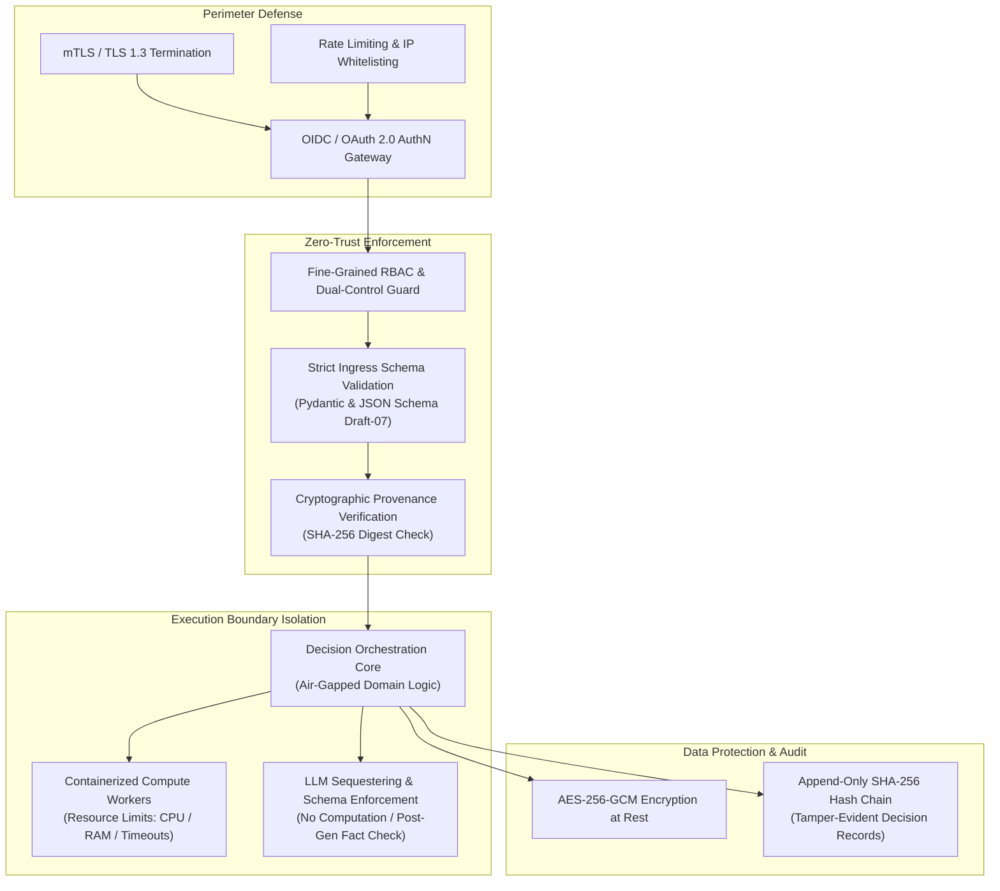
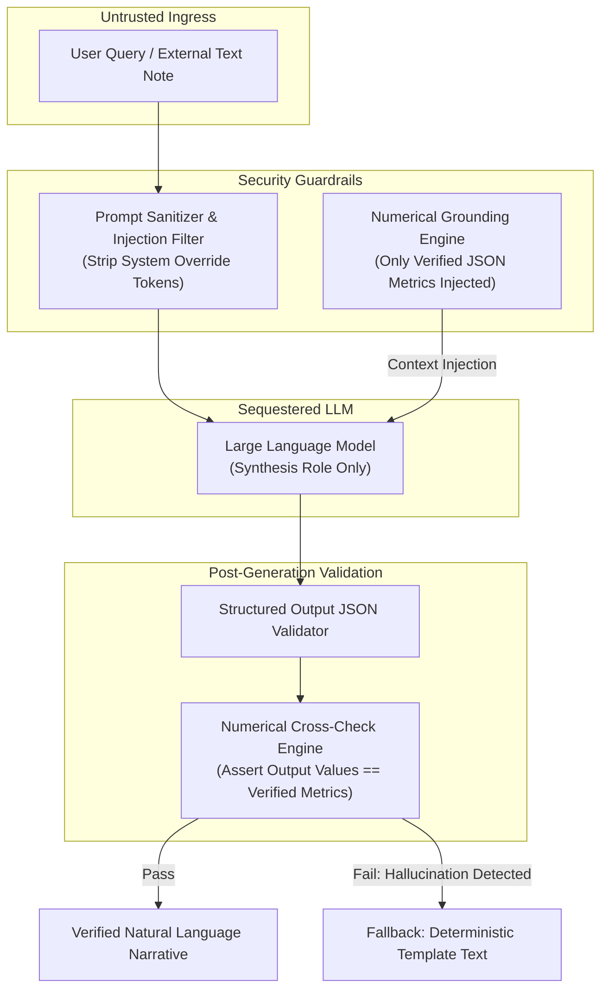

# NIRNAYA — Security Architecture & Threat Model

## Document Metadata
- **Status:** PROVISIONAL — FOR ARCHITECTURAL REVIEW
- **Phase:** 0 — Engineering Foundation
- **Classification:** Security Architecture & STRIDE Threat Analysis
- **Author:** Principal Software Architect & Systems Engineering Lead

---

## 1. Security Architecture & Defense-in-Depth

NIRNAYA operates at the intersection of critical power grid infrastructure and AI-assisted decision making. Consequently, the platform is architected under **Zero-Trust** principles and complies conceptually with NERC Critical Infrastructure Protection (CIP) and Critical Energy Infrastructure Information (CEII) standards.

---

## 2. Authentication, Authorization, & Separation of Duties (SoD)

### 2.1 Role-Based Access Control (RBAC) Matrix
NIRNAYA defines strict functional roles to prevent privilege escalation:

| Role Identifier | Description | Ingress / Formulate | Run Simulations | Sign Primary Sign-Off | Sign Secondary Sign-Off | View Audits |
| :--- | :--- | :---: | :---: | :---: | :---: | :---: |
| **`ROLE_OBSERVER`** | Read-only situational monitor (e.g., civil agency observer) | ❌ | ❌ | ❌ | ❌ | ✅ |
| **`ROLE_ANALYST`** | Operations planning engineer configuring models/scenarios | ✅ | ✅ | ❌ | ❌ | ✅ |
| **`ROLE_DISPATCHER`** | Real-time Grid Control Dispatcher | ✅ | ✅ | ✅ (Low-Impact) | ❌ | ✅ |
| **`ROLE_SUPERVISOR`** | Senior Grid Controller / Shift Lead | ✅ | ✅ | ✅ (All Plans) | ❌ | ✅ |
| **`ROLE_INCIDENT_COMMANDER`** | Joint Emergency Operations Center Lead | ❌ | ❌ | ❌ | ✅ (Civil Impact) | ✅ |
| **`ROLE_AUDITOR`** | Forensic compliance investigator | ❌ | ❌ | ❌ | ❌ | ✅ (Unrestricted) |

### 2.2 Separation of Recommendation Generation vs. Approval Authority
To eliminate algorithmic bias and human rubber-stamping:
1. **Algorithmic Decoupling:** The Decision Engine produces candidate recommendations tagged with non-dominated Pareto ranks, but possesses **zero authority** to mark any plan as `AUTHORIZED`.
2. **Dual-Control (Four-Eyes Principle):** For any operational scenario involving:
   - Feeder load shedding $>10 \text{ MW}$,
   - Transmission line switching resulting in an electrical island,
   - Bypassing statutory voltage margins ($V < 0.95 \text{ p.u.}$),
   NIRNAYA mandates **two distinct authenticated individuals** from different operational jurisdictions (e.g., Senior Grid Controller + Incident Commander). A single user attempting to sign both primary and secondary authorizations is rejected at the API boundary.

---

## 3. Protection of Operational & Critical Energy Infrastructure Information (CEII)

1. **Encryption in Transit:** All network traffic (HTTP, WebSocket, gRPC) enforces TLS 1.3 with forward-secret cipher suites (`TLS_AES_256_GCM_SHA384`, `TLS_CHACHA20_POLY1305_SHA256`). Internal microservices and worker nodes communicate over Mutual TLS (mTLS) with dedicated internal certificate authorities (CA).
2. **Encryption at Rest:** All PostgreSQL tables, PostGIS spatial data, and object storage buckets are encrypted using AES-256-GCM with hardware-security-module (HSM) managed keys.
3. **CEII Data Sanitization in Logs:** All bus names, exact geographic coordinates of substations, and generator asset tags are redacted or pseudonymized in application log streams to prevent leakage in log aggregators.
4. **Secrets Management:** No secrets, database passwords, or cryptographic keys are stored in code or config files. All secrets are injected dynamically via environment variables sourced from enterprise secret vaults (e.g., HashiCorp Vault, AWS Secrets Manager, or GCP Secret Manager).

---

## 4. LLM Security, Prompt Injection, and Model Sequestering

NIRNAYA incorporates Large Language Models strictly for natural-language synthesis, query assistance, and evidence narrative formatting. Because LLMs are susceptible to prompt injection, hallucination, and probabilistic errors, the engine enforces strict defensive boundaries:

### LLM Safety Invariants
1. **Zero Mathematical Reliance:** The LLM is never prompted to calculate power flow, verify line limits, rank Pareto candidates, or compute regret. All calculations are executed by compiled mathematical libraries (NumPy, SciPy, HiGHS).
2. **Context Pinning:** The LLM context window is populated exclusively with verified JSON snippets from `ModelEvaluation` and `StrategyComparison` artifacts.
3. **Automated Hallucination Detection:** A post-generation verification step scans the generated narrative with regular expressions. Any numeric value in the narrative that does not match an approved metric in the `ModelEvaluation` artifact causes the LLM response to be discarded and replaced with a deterministic template.

---

## 5. Comprehensive STRIDE Threat Model

The table below documents identified threats across the STRIDE taxonomy, evaluated impacts, engineered mitigations, and explicit verification methods.

| Threat ID | STRIDE Category | Threat Description & Attack Vector | Potential Impact | Engineered Mitigation Strategy | Verification Method |
| :--- | :--- | :--- | :--- | :--- | :--- |
| **TH-01** | **Spoofing** | Adversary injects forged telemetry snapshots claiming lines are tripped to induce unnecessary load shedding. | Disruption of service; economic damage; cascading grid instability. | Ingress adapter validates mTLS client certificates and verifies digital signature of snapshot using VAJRA-Ω public key. | Automated test with forged cryptographic signatures; assert rejection at adapter edge. |
| **TH-02** | **Tampering** | Malicious insider modifies objective values in database to make a dangerous candidate strategy appear optimal. | Operator authorizes suboptimal or hazardous switching plan. | Candidate evaluations are signed into an append-only SHA-256 hash chain upon creation. Database tampering breaks the hash chain. | Hash chain consistency verification script; inject artificial row edit and assert audit alert. |
| **TH-03** | **Repudiation** | Operator executes an unauthorized load shed and later claims NIRNAYA recommended and authorized it automatically. | Inability to establish legal liability during post-blackout regulatory audit. | Dual-control digital signatures (ECDSA-P256) embedded in immutable `DecisionRecord`. System never acts autonomously. | Cryptographic signature verification suite; assert record cannot be generated without private key sign-off. |
| **TH-04** | **Information Disclosure** | Adversary intercepts telemetry feeds or decision records containing critical transmission line vulnerabilities. | Exposure of CEII data enabling targeted physical or cyber attacks on key substations. | TLS 1.3 encryption on all transports; AES-256 encryption at rest; CEII redaction in external logs. | Network packet sniffing test during active simulation; verify zero plaintext transmission network data. |
| **TH-05** | **Denial of Service** | Adversary submits pathological, numerically ill-conditioned power grid topologies causing solver worker to spin infinitely. | Compute worker pool exhaustion; grid control room delayed during active emergency. | Strict solver execution timeouts (15s per scenario); worker memory limits (cgroups / container limits); bounded queue depth. | Stress testing with non-convergent, ill-conditioned Jacobian matrices; assert hard timeout termination within 15s. |
| **TH-06** | **Elevation of Privilege** | Dispatcher alters API token claims to execute secondary authorization without the Incident Commander. | Unilateral execution of emergency load shedding, bypassing Four-Eyes safety controls. | Backend validates JWT claims against cryptographically signed session tokens; enforces distinct user ID and distinct role checks. | Penetration test attempting dual sign-off with identical credentials; assert HTTP 403 Forbidden. |
| **TH-07** | **Tampering (Supply Chain)** | Malicious third-party Python package injected into scientific solver dependency tree. | Arbitrary code execution or deliberate falsification of optimization outputs. | Dependency pinning with SHA-256 hash checking; automated vulnerability scanning (pip-audit, Dependabot); minimal dependency surface. | CI automated lockfile hash verification; daily vulnerability scanning in pipeline. |
| **TH-08** | **Denial of Service (Stale Data)** | Intermittent communication loss with VAJRA-Ω causes engine to evaluate actions based on outdated grid topology. | Grid operations executed on erroneous topology, causing breaker tripping and equipment damage. | Freshness monitor tracks telemetry age; transitions to `DEGRADED` at 30s and hard `FAIL-CLOSED LOCKOUT` at 120s. | Simulation of telemetry stream interruption; verify UI lockout and API rejection after 120s. |

---

## 6. Safe Failure Modes & Fail-Closed Boundaries

NIRNAYA enforces deterministic, fail-safe behaviors across all boundary failure scenarios:

| Failure Scenario | Immediate System Reaction | Operational Status | Fallback Action |
| :--- | :--- | :--- | :--- |
| **VAJRA-Ω Ingress Disruption** | Ingress adapter raises `TELEMETRY_DISCONNECTED`; freshness countdown reaches 120s. | `FAIL_CLOSED_LOCKOUT` | New case evaluations disabled. Command center displays red warning and points operator to physical SCADA meters. |
| **AAROHAN-α Ingress Disruption** | AAROHAN adapter flags incident context as `STALE_INCIDENT_DATA`. | `DEGRADED_OPERATIONS` | Informs operator that hazard perimeters are frozen at last known report; allows power grid analysis with explicit hazard disclaimer. |
| **Solver Numerical Divergence** | Solver raises non-convergence exception; returns `outcome_state = UNKNOWN`. | `ISOLATED_SCENARIO_FAILURE` | Scenario is flagged `UNKNOWN` and quarantined. **Never marked FEASIBLE.** Remaining scenarios in batch continue processing. |
| **Worker Node Crash / OOM** | Worker process terminates abruptly; worker lease heartbeat expires ($>15$s). | `JOB_REQUEUED` | Task broker requeues scenario to an alternate worker node up to 3 times. If repeated, scenario marked `UNKNOWN`. |
| **Contradictory Telemetry Inputs** | Ingress state estimator reports bus voltage $<0.5$ p.u. but line active flow is normal (measurement conflict). | `TELEMETRY_UNRELIABLE` | System marks telemetry quality as `UNRELIABLE`, refuses automated scenario formulation, and raises an instrumentation alarm. |
