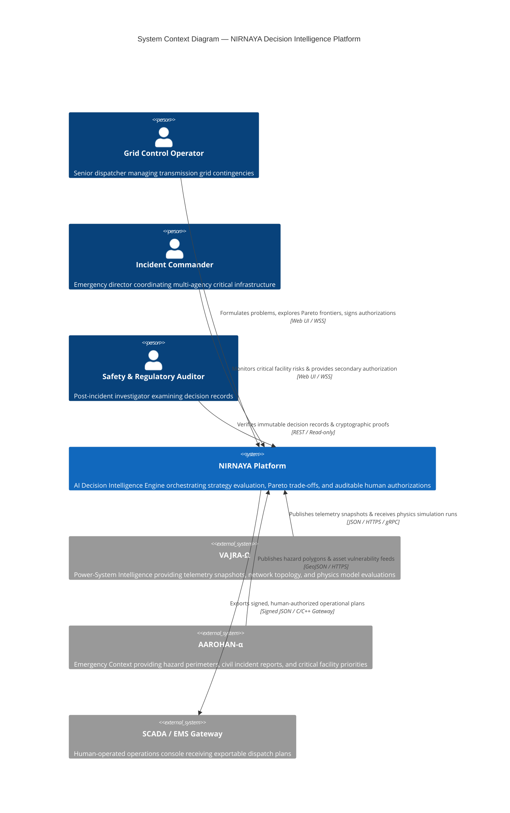
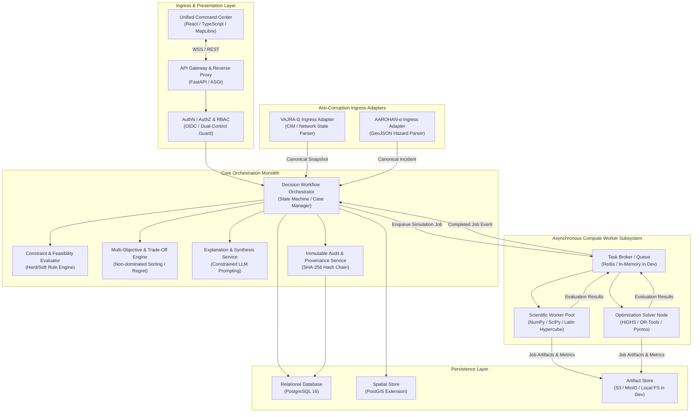
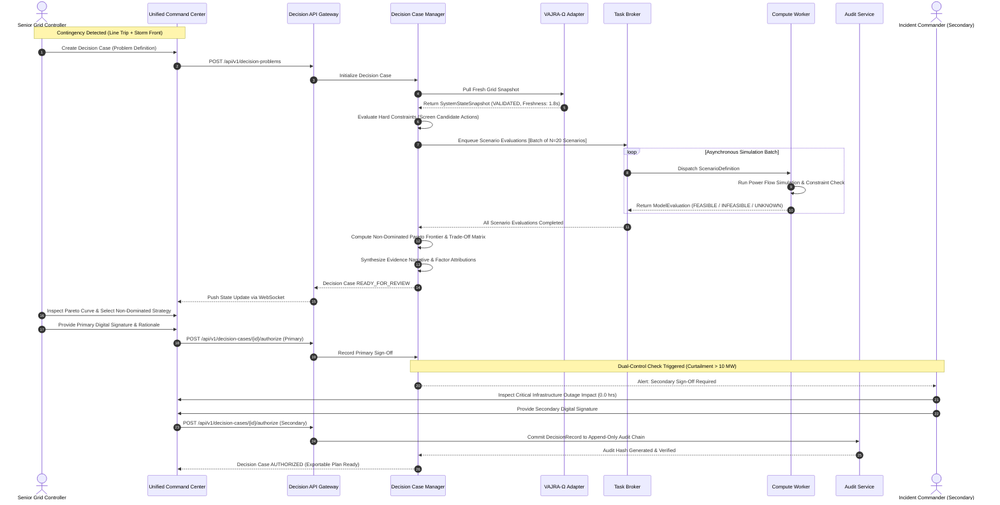
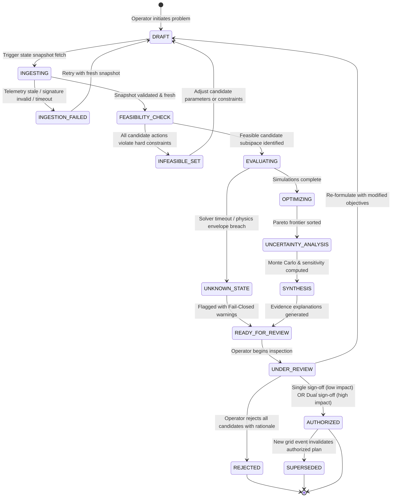
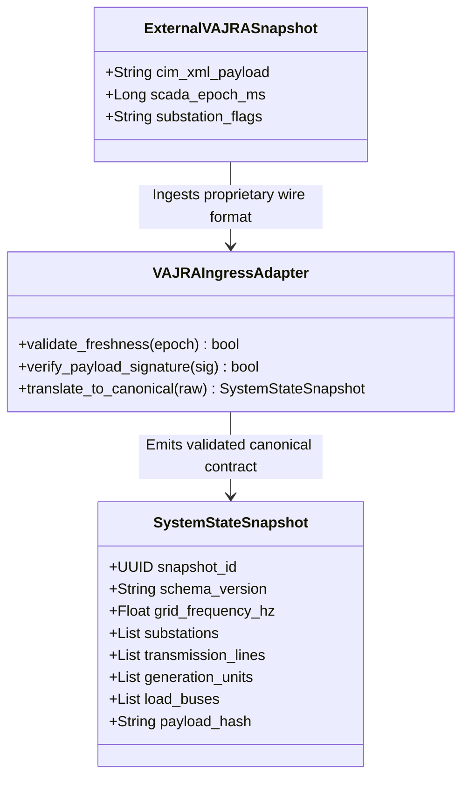
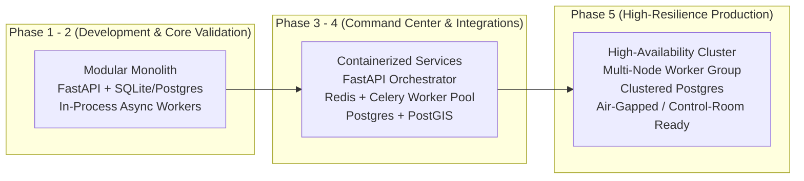

# NIRNAYA — System Architecture Specification

## Document Metadata
- **Status:** PROVISIONAL — FOR ARCHITECTURAL REVIEW
- **Phase:** 0 — Engineering Foundation
- **Classification:** Architecture Design Document (ADD)
- **Author:** Principal Software Architect & Systems Engineering Lead

---

## 1. Architectural Principles & System Context

NIRNAYA is architected around four foundational principles:
1. **Separation of Decision Orchestration from Numerical Computation:** Orchestrating workflows, managing state, handling API traffic, and storing audit logs must never block on or be entangled with heavy scientific or mathematical solvers.
2. **Strict Invariant Enforcement via Hexagonal/Clean Architecture:** Core decision domain logic must have zero knowledge of external database drivers, web frameworks, or third-party physics solvers.
3. **Fail-Closed by Design:** Any unresolvable numerical condition, stale telemetry packet, or schema violation must halt the scenario pipeline and raise an explicit `UNKNOWN` state rather than defaulting to an optimistic `FEASIBLE` classification.
4. **Independent Domain Adapters (Anti-Corruption Layer):** All data crossing the boundary from external systems (VAJRA-Ω, AAROHAN-α) is translated into canonical, versioned internal contracts with cryptographic provenance.

### System Context Diagram (C4 Level 1)



---

## 2. Logical Architecture & Subsystem Responsibilities

NIRNAYA follows a **Modular Monolith** architecture for its control plane and orchestration core, combined with an isolated **Computational Worker Subsystem** for heavy numerical evaluations.



### Component Responsibility Matrix

| Subsystem | Component | Technology | Primary Responsibility |
| :--- | :--- | :--- | :--- |
| **Edge & Ingress** | API Gateway | FastAPI / Uvicorn | Request validation, rate limiting, OpenAPI contract enforcement, TLS termination. |
| **Security** | Auth & Dual-Control Guard | Custom Python / Pydantic | Validates JWTs, verifies role permissions, enforces Four-Eyes protocol for high-impact decisions. |
| **Orchestration** | Decision Case Manager | Python 3.14 (AsyncIO) | Manages decision case lifecycle, state transitions, task coordination, and persistence transactions. |
| **Domain Logic** | Feasibility Evaluator | Python / NumPy | Evaluates hard inequality and equality constraints ($g_i(x) \le 0, h_j(x) = 0$); filters out infeasible actions. |
| **Domain Logic** | Multi-Objective Engine | Python / SciPy | Executes non-dominated sorting (NSGA-II sorting core), derives Pareto trade-off frontiers, computes regret. |
| **Domain Logic** | Synthesis Service | Python / LiteLLM / Gemini | Synthesizes factor attribution narratives and counterfactual explanations; strictly bounded by output schemas. |
| **Auditing** | Audit & Provenance Service | Python / Cryptography | Generates append-only SHA-256 hash chains of all evaluations, inputs, and operator signatures. |
| **Adapters** | VAJRA-Ω Ingress Adapter | Python / Pydantic | Ingests external power grid telemetry, checks freshness, translates to `SystemStateSnapshot`. |
| **Adapters** | AAROHAN-α Ingress Adapter | Python / Shapely / GeoJSON | Ingests emergency hazard geometries, maps affected critical facilities, translates to `IncidentContext`. |
| **Computation** | Scientific Worker Pool | Python / Celery / RQ | Runs Latin Hypercube sampling, Monte Carlo stochastic simulations, and parameter sensitivity runs. |
| **Computation** | Optimization Solver Node | HiGHS / OR-Tools / Pyomo | Formulates and solves mixed-integer linear and non-linear mathematical programs. |
| **Storage** | Transactional & Spatial Store | PostgreSQL 16 + PostGIS | Stores decision problems, cases, relational entities, geospatial network topologies, and audit trails. |
| **Storage** | Artifact & Blob Store | MinIO / S3 / Local Directory | Stores high-volume telemetry matrices, raw solver output logs, and simulation trace dumps. |

---

## 3. End-to-End Decision Execution Flow

The sequence diagram below details the path from initial contingency detection to authorized decision record generation.



---

## 4. Decision Execution Lifecycle & State Machine

Every decision case in NIRNAYA transitions through a strictly validated, deterministic state machine.



### State Definitions & Safety Invariants

1. **`DRAFT`:** Problem definition is being configured (objectives selected, candidate actions populated).
2. **`INGESTING`:** System is querying external adapters for fresh `SystemStateSnapshot` and `IncidentContext`.
3. **`INGESTION_FAILED`:** Ingress data exceeded freshness thresholds ($>30$s) or failed cryptographic hash check.
4. **`FEASIBILITY_CHECK`:** Mathematical screening of candidate actions against hard constraints ($g_i(x) \le 0$).
5. **`EVALUATING`:** Background workers are executing numerical solvers across defined scenarios.
6. **`UNKNOWN_STATE`:** Solver returned numerical divergence or execution timed out. **Safety Invariant:** Scenarios in `UNKNOWN_STATE` are quarantined and can never be selected for operational authorization.
7. **`OPTIMIZING`:** Calculation of Pareto non-dominated sets and hypervolume metrics.
8. **`UNCERTAINTY_ANALYSIS`:** Sampling over aleatory distributions and calculating max regret over bounded uncertainty sets.
9. **`SYNTHESIS`:** Fact-checked textual justification generated from numerical evaluation artifacts.
10. **`READY_FOR_REVIEW` / `UNDER_REVIEW`:** Case presented in the Command Center for human inspection.
11. **`AUTHORIZED`:** Cryptographically signed by required authorities. Plan exported for manual operator dispatch.

---

## 5. Domain Adapter Boundaries (Anti-Corruption Layer)

NIRNAYA enforces an **Anti-Corruption Layer (ACL)** between internal decision models and external systems.



### Adapter Safety Rules
- **Schema Validation Gate:** Ingress adapters run Pydantic/JSON Schema validation before any domain processing occurs. Malformed payloads are rejected at the edge.
- **Freshness Envelopes:** Snapshots older than 30 seconds trigger `DEGRADED` warnings; snapshots older than 120 seconds cause the adapter to refuse problem initialization (`FAIL_CLOSED`).
- **Cryptographic Provenance:** Ingress adapters record a SHA-256 hash of the exact raw bytes received to ensure external domain data can be audited forensically.

---

## 6. Persistence & Storage Responsibilities

NIRNAYA implements a hybrid storage architecture:

```
┌────────────────────────────────────────────────────────────────────────┐
│                        NIRNAYA PERSISTENCE ARCHITECTURE                │
├────────────────────────────────┬───────────────────────────────────────┤
│ PostgreSQL 16 (Relational DB)  │ - Decision problem specifications     │
│                                │ - Scenario metadata and statuses      │
│                                │ - Evaluated objective values          │
│                                │ - User identity, roles, and sessions  │
│                                │ - Append-only DecisionRecord hashes   │
├────────────────────────────────┼───────────────────────────────────────┤
│ PostGIS (Spatial Extension)    │ - Transmission line geometries (WKT)  │
│                                │ - Substation coordinates (Point)      │
│                                │ - Hazard impact perimeters (Polygon)  │
│                                │ - Critical asset geo-containment      │
├────────────────────────────────┼───────────────────────────────────────┤
│ Object Store (MinIO / S3)      │ - Raw external CIM/SCADA snapshots    │
│ (Local FS in Phase 0-1)        │ - Full solver log traces & matrices   │
│                                │ - Monte Carlo sample distributions    │
│                                │ - Signed exportable PDF/JSON dossiers │
└────────────────────────────────┴───────────────────────────────────────┘
```

---

## 7. Long-Running Worker Recovery & Idempotency

Scientific simulations and Monte Carlo optimizations can take from seconds to minutes. NIRNAYA enforces robust worker handling:

1. **Job Leases with Heartbeats:** Workers acquire an execution lease on a scenario job. If a worker fails to send a heartbeat for $>15$ seconds, the job is reclaimed and requeued up to a maximum of 3 attempts.
2. **Deterministic Seed Tracking:** Every `ScenarioDefinition` contains a 64-bit integer seed (`simulation_seed`). Re-executing a scenario produces identical pseudo-random sequences for wind gusts, load fluctuations, and generator trips.
3. **Idempotent Job Completion:** If two workers complete the same scenario evaluation concurrently (due to network partitioning), the orchestrator deduplicates based on `(scenario_id, simulation_seed, solver_version)` and keeps the first verified artifact.

---

## 8. Observability, Error Handling, and Resilience

NIRNAYA adopts the **OpenTelemetry** standard for system observability:
- **Distributed Tracing:** Every decision case assigns a `TraceID` that propagates through API gateway, orchestration state machine, background task broker, and worker nodes.
- **Structured JSON Logging:** All log entries output structured JSON containing `case_id`, `problem_id`, `operator_id`, and `execution_state`.
- **Circuit Breakers on External Adapters:** Calls to external systems (e.g., querying VAJRA-Ω or AAROHAN-α) are wrapped in circuit breakers (failure threshold: 5 consecutive failures, reset timeout: 30 seconds).

---

## 9. Deployment Evolution Strategy



- **Phase 0 (Current):** Engineering foundation and verified documentation; no application deployment.
- **Phase 1-2:** Modular monolith running in a single container or development environment with asynchronous worker threads or local Redis queues.
- **Phase 3-4:** Decoupled container stack via Docker Compose / Helm charts separating API orchestrator, frontend client, and auto-scaling Celery compute worker nodes.
- **Phase 5:** Hardened, redundant control-room deployment supporting air-gapped on-premise infrastructure with hardware-security-module (HSM) signing.
