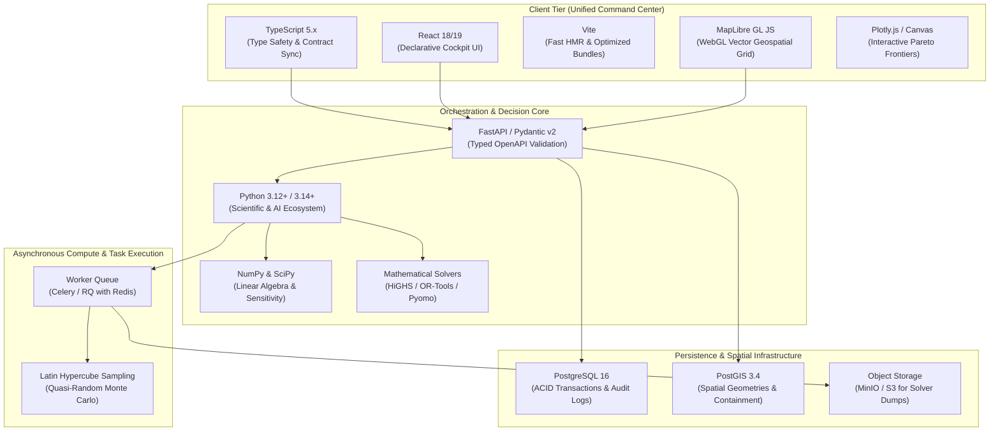

# NIRNAYA — Technology Selection & Repository Specification

## Document Metadata
- **Status:** PROVISIONAL — FOR ARCHITECTURAL REVIEW
- **Phase:** 0 — Engineering Foundation
- **Classification:** Technology Stack Selection & Repository Architecture
- **Author:** Principal Software Architect & Systems Engineering Lead

---

## 1. Subsystem Technology Justification Matrix

NIRNAYA adopts a disciplined, polyglot technology stack chosen strictly by subsystem engineering responsibility rather than trend or uniformity.



### Detailed Subsystem Engineering Rationales

| Subsystem | Selected Technology | Engineering Justification | Discarded Alternatives & Why |
| :--- | :--- | :--- | :--- |
| **Presentation Tier** | **TypeScript 5.x + React 18/19 + Vite** | High type safety allows automated code generation of TypeScript types from canonical JSON Schemas, guaranteeing front-to-back contract synchronicity. React’s component model supports dense, multi-pane real-time dashboards with decoupled state updates. Vite provides fast HMR and lightweight bundle trees. | *Angular / Blazor:* Angular introduces heavy framework lock-in and steep ergonomics overhead; Blazor has high WebAssembly startup latency and poor WebGL ecosystem integration. |
| **Geospatial Engine** | **MapLibre GL JS** | Open-source, GPU-accelerated WebGL vector tile renderer capable of rendering 100,000+ electrical buses, lines, and dynamic hazard perimeters at 60 FPS without UI jank. Free from proprietary token licensing fees (unlike Mapbox). | *Leaflet:* DOM-based rendering degrades severely when rendering large transmission networks (>2,000 interactive vector branches). *OpenLayers:* Excessively verbose API with inferior WebGL shader performance. |
| **Decision Orchestration Core** | **Python 3.12+ (FastAPI + Pydantic v2)** | Python is the uncontested industry standard for scientific computing, mathematical programming, and AI orchestration. FastAPI provides native asynchronous ASGI performance, automatic OpenAPI documentation, and high-speed Rust-backed validation via Pydantic v2. | *Node.js / Express:* JavaScript lacks mature, robust scientific optimization and multi-physics solver libraries. *Go (Golang):* Excellent for microservices, but scientific and non-linear optimization bindings in Go are severely immature compared to Python's ecosystem. |
| **Scientific Computing** | **NumPy & SciPy** | Hardware-accelerated C/Fortran bindings (BLAS/LAPACK) provide optimal vectorized linear algebra for bus-admittance matrix ($Y_{\text{bus}}$) computations, power flow Jacobians, and eigenvalue sensitivity analysis. | *Pure Python loops:* Computationally prohibitive ($100\times$ slower) for power system matrix operations. |
| **Mathematical Optimization** | **HiGHS & Google OR-Tools (with Pyomo)** | **HiGHS** is currently the world’s fastest open-source mixed-integer linear programming (MILP) solver. **OR-Tools** excels in constraint programming (CP-SAT) for discrete switching logic. **Pyomo** provides an algebraic modeling layer allowing solver switching (e.g., swapping HiGHS for commercial Gurobi/CPLEX without rewriting domain models). | *Pure SciPy.optimize:* SciPy’s solvers are unsuited for large-scale mixed-integer programming with thousands of binary switching variables. |
| **Persistence Layer** | **PostgreSQL 16 + PostGIS 3.4** | Rock-solid ACID transactional guarantees essential for legal decision records. JSONB fields allow indexing semi-structured scenario telemetry without losing relational integrity. PostGIS delivers native spatial indexing (`ST_Contains`, `ST_DWithin`) to calculate grid assets within storm/flood polygons. | *MongoDB:* Lacks robust multi-table ACID guarantees required for audit trails; spatial indexing is less mathematically rigorous than PostGIS. *MySQL:* Inferior spatial geometry algorithms and less performant JSONB querying. |
| **Compute Worker Brokering** | **Redis + Celery (or RQ)** | Lightweight, battle-tested asynchronous distributed task queue capable of task leasing, heartbeat monitoring, retry policies, and worker node scaling. | *Direct threading:* Long-running Monte Carlo simulations would starve the ASGI event loop and crash the API process on out-of-memory (OOM) events. |

---

## 2. Engineering Criteria for Additional Technologies

To maintain architectural minimalism, the following technologies are **explicitly deferred** until concrete operational metrics justify them:

### When C++ is Justified
- **Condition:** In-loop dynamic AC power flow simulations exceed the throughput capacity of vectorized NumPy/SciPy (e.g., executing $>10,000$ full AC contingency evaluations per second for online transient stability screening).
- **Architecture Path:** Wrap a high-performance C++ solver core (e.g., GridDyn, KLU sparse solver) using `pybind11` as a compiled C-extension module within the worker pool.

### When Java is Justified
- **Condition:** Direct, low-latency integration is mandated with enterprise legacy power utility systems utilizing the full IEC 61970 Common Information Model (CIM) Java ecosystem (e.g., Eclipse BaSyx, GridX, OpenFMB).
- **Architecture Path:** Isolate Java into an independent Ingress Gateway service communicating with NIRNAYA via canonical gRPC contracts.

### When Apache Kafka / RabbitMQ is Justified
- **Condition:** Continuous real-time SCADA phasor measurement unit (PMU) telemetry ingress exceeds 50,000 events/second across thousands of substations.
- **Architecture Path:** Introduce Kafka at the perimeter edge solely for telemetry streaming, with dedicated ingress workers writing aggregated snapshots to PostgreSQL/MinIO.

### When Dedicated Object Storage (MinIO / S3) is Justified
- **Condition:** Historical scenario execution logs, full-network contingency traces, and Monte Carlo sample matrices exceed 500 GB, degrading relational database backup windows.
- **Architecture Path:** Persist metadata and decision records in PostgreSQL, while offloading raw simulation output matrices (`.parquet` / `.npz` blobs) to S3/MinIO referenced by cryptographic URI.

---

## 3. Comprehensive Target Repository Structure

The target repository structure enforces separation between core domain logic, contracts, presentation, worker tasks, and infrastructure.

```
nirnaya/
├── README.md                               # Root project mission, status, and navigation
├── LICENSE                                 # Legal licensing and governance
├── .gitignore                              # Git exclusion rules
├── contracts/                              # Canonical contract definitions (Language Agnostic)
│   ├── schemas/                            # JSON Schema Draft-07 specifications
│   │   ├── system_state_snapshot.json
│   │   ├── incident_context.json
│   │   ├── decision_problem.json
│   │   ├── scenario_definition.json
│   │   ├── model_evaluation.json
│   │   ├── strategy_comparison.json
│   │   └── decision_record.json
│   └── examples/                           # Concrete validated example instances
│       ├── system_state_snapshot.example.json
│       ├── incident_context.example.json
│       ├── decision_problem.example.json
│       ├── scenario_definition.example.json
│       ├── model_evaluation.example.json
│       ├── strategy_comparison.example.json
│       └── decision_record.example.json
├── docs/                                   # Authoritative Phase 0 Documentation
│   ├── vision/
│   │   └── mission-and-scope.md
│   ├── architecture/
│   │   ├── system-architecture.md
│   │   ├── technology-and-repository.md
│   │   ├── security-and-threat-model.md
│   │   └── decision-log.md
│   ├── decision-models/
│   │   └── decision-model-specification.md
│   ├── integrations/
│   │   └── integration-contracts.md
│   ├── ui-ux/
│   │   └── unified-command-center.md
│   ├── verification/
│   │   └── acceptance-criteria.md
│   └── roadmap.md
├── apps/                                   # Top-level applications (Scaffolded in Phase 3)
│   ├── command-center/                     # React/TypeScript/Vite frontend UI
│   │   ├── src/
│   │   │   ├── components/                 # Geospatial, Pareto, and Audit UI components
│   │   │   ├── contracts/                  # Auto-generated TypeScript types from schemas
│   │   │   └── store/                      # Real-time state management
│   │   ├── package.json
│   │   └── vite.config.ts
│   └── api-server/                         # FastAPI application entry points
│       └── src/
├── services/                               # Core backend services & engines (Phase 1-2)
│   ├── decision-core/                      # Decision orchestration, state machine
│   │   ├── domain/                         # Pure domain logic (D = S, A, C, O, M, U, E)
│   │   ├── optimization/                   # HiGHS / OR-Tools / Pareto sorting
│   │   ├── feasibility/                    # Hard & soft constraint evaluation
│   │   └── explanation/                    # Evidence-grounded synthesis
│   ├── compute-workers/                    # Distributed background simulation runners
│   │   ├── tasks/                          # Celery task definitions
│   │   └── sampling/                       # Latin Hypercube & Monte Carlo engines
│   └── audit-service/                      # Cryptographic signing and hash chaining
├── integrations/                           # Anti-Corruption Layer adapters (Phase 4)
│   ├── vajra-adapter/                      # VAJRA-Ω Ingress Adapter
│   └── aarohan-adapter/                    # AAROHAN-α Ingress Adapter
├── tests/                                  # Comprehensive automated test suites
│   ├── unit/                               # Pure function & mathematical unit tests
│   ├── property/                           # Hypothesis property-based solver tests
│   ├── contracts/                          # JSON Schema & contract regression tests
│   ├── integration/                        # Database & worker integration tests
│   └── e2e/                                # Playwright full-flow scenario tests
├── migrations/                             # PostgreSQL DDL migrations (Alembic)
└── infra/                                  # Deployment configurations (Phase 5)
    ├── docker/                             # Dockerfiles for API, worker, and frontend
    └── compose/                            # Docker Compose for local development
```

> [!IMPORTANT]
> **Phase 0 Rule:** No application code, package manager manifests (`package.json`, `pyproject.toml`), or dependencies are created in `apps/`, `services/`, or `infra/` during Phase 0. These directories are documented as architectural targets to be implemented progressively in subsequent phases.
