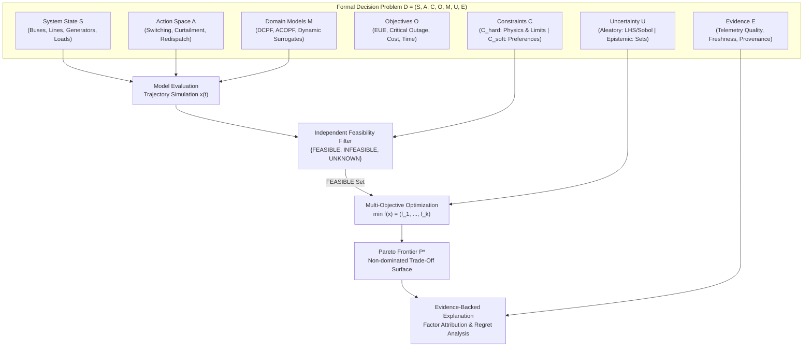
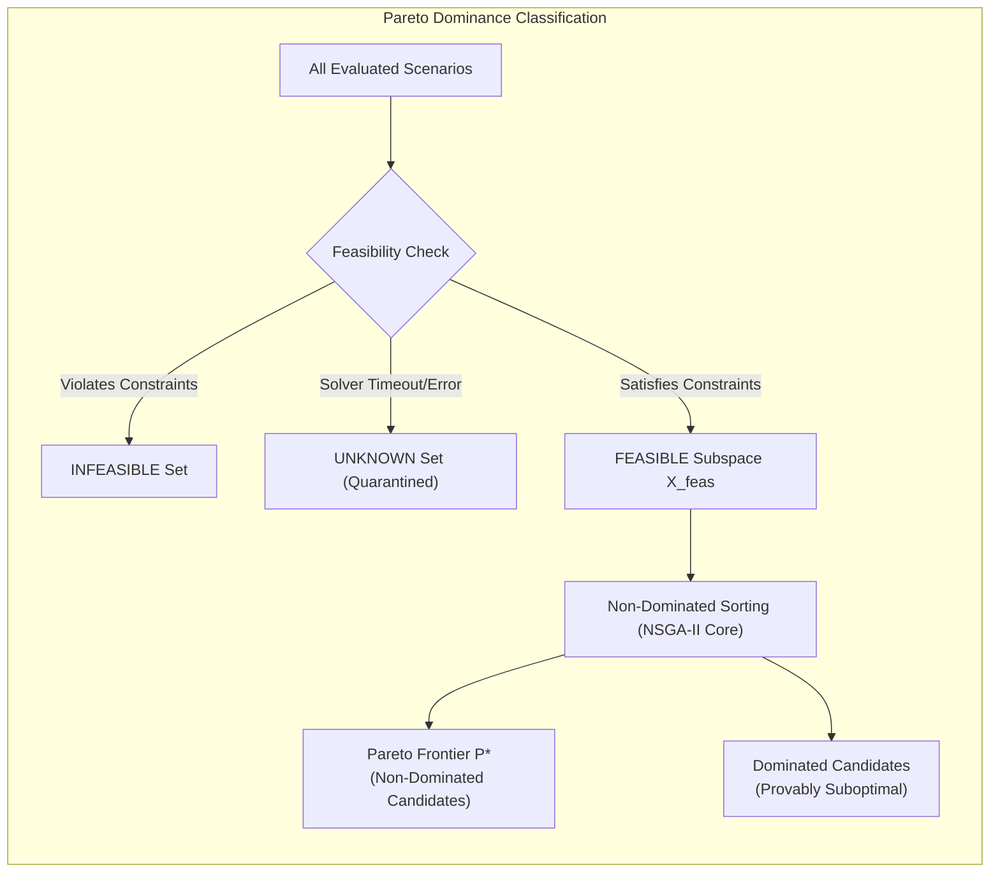

# NIRNAYA — Mathematical Decision-Engine Specification

## Document Metadata
- **Status:** PROVISIONAL — FOR ARCHITECTURAL REVIEW
- **Phase:** 0 — Engineering Foundation
- **Classification:** Mathematical & Algorithmic Foundation Specification
- **Author:** Principal Decision Intelligence Engineer & Scientific Computing Specialist

---

## 1. Formal Decision Problem Representation

In NIRNAYA, every decision-intelligence evaluation is formalized as an auditable 7-tuple:

$$\mathcal{D} = (S, A, C, O, M, U, E)$$

Where:
- $\mathbf{S} \in \mathcal{S}$ is the **System State** representing the physical topology, operational parameters, and environmental conditions at decision epoch $t_0$.
- $\mathbf{A} \subseteq \mathcal{A}$ is the **Action Space** of admissible discrete, continuous, and composite operational interventions.
- $\mathbf{C} = C_{\text{hard}} \cup C_{\text{soft}}$ is the set of **Constraints** governing physical laws, equipment limits, and operational policies.
- $\mathbf{O} = (f_1, f_2, \dots, f_k)$ is the vector of **Objective Functions** with explicit physical units and optimization directions.
- $\mathbf{M}$ is the collection of **Domain Physics Models** and simulators mapping $(S, x)$ to predicted future trajectories.
- $\mathbf{U}$ is the **Uncertainty Specification** comprising aleatory probability distributions and epistemic uncertainty sets.
- $\mathbf{E}$ is the **Evidence Chain** providing sensor confidence, measurement timestamps, and cryptographic data provenance.

---

## 2. Mathematical State & Action Space Formulation

### 2.1 System State Space ($S$)
The system state $S$ at decision epoch $t_0$ encapsulates:
1. **Network Topology Graph:** $\mathcal{G} = (\mathcal{V}, \mathcal{E})$, where $\mathcal{V}$ denotes electrical substations and buses ($|\mathcal{V}| = N_b$), and $\mathcal{E}$ denotes transmission lines and transformers ($|\mathcal{E}| = N_l$).
2. **Bus State Vector:** For each bus $i \in \mathcal{V}$:
   - Complex voltage phasor $V_i = |V_i| e^{j \theta_i}$, with magnitude $|V_i|$ (kV or p.u.) and phase angle $\theta_i$ (rad).
   - Net active power injection $P_i = P_{g,i} - P_{d,i}$ (MW).
   - Net reactive power injection $Q_i = Q_{g,i} - Q_{d,i}$ (MVAR).
3. **Branch Flow Vector:** For each transmission line $(i, k) \in \mathcal{E}$:
   - Active power flow $P_{ik}$ (MW) and reactive power flow $Q_{ik}$ (MVAR).
   - Breaker operational status $s_{ik} \in \{0, 1\}$ (0 = Open, 1 = Closed).
   - Dynamic line rating / thermal capacity $S_{ik}^{\max}$ (MVA).
4. **Generating Units:** For each generator $g \in \mathcal{G}_{\text{gen}}$:
   - Synchronized status $u_g \in \{0, 1\}$.
   - Active power output $P_g$ (MW), bounded by $[P_g^{\min}, P_g^{\max}]$.
   - Ramp-rate capability $R_g$ (MW/min).
5. **Demand & Priority Tiers:** For each load bus $j \in \mathcal{V}_{\text{load}}$:
   - Nominal demand $P_{d,j}$ (MW).
   - Served power $P_{s,j}$ and shed power $P_{\text{shed},j} = P_{d,j} - P_{s,j}$.
   - Priority tier $w_j \in \{1, 2, 3, 4, 5\}$, where Tier 1 designates critical life-safety assets (trauma centers, municipal water pumping).

### 2.2 Action Space ($A$)
An operational strategy vector $x \in A$ comprises hybrid decision variables:

$$x = \left( x_{\text{discrete}}, x_{\text{continuous}} \right)$$

1. **Discrete Switching Actions ($x_{\text{discrete}}$):**
   - Line reclosing / isolation: $z_{ik} \in \{0, 1\}, \forall (i,k) \in \mathcal{E}_{\text{switchable}}$.
   - Bus coupler operation / substation sectionalizing: $y_b \in \{0, 1\}$.
   - Feeder block shedding: $u_{\text{shed}, j} \in \{0, 1\}, \forall j \in \mathcal{V}_{\text{sheddable}}$.
2. **Continuous Control Variables ($x_{\text{continuous}}$):**
   - Generator active power setpoint adjustments: $\Delta P_g \in [-R_g \cdot \Delta t, R_g \cdot \Delta t]$.
   - Battery energy storage charge/discharge injection: $P_{\text{bat}, b} \in [-P_{\text{bat}, b}^{\max}, P_{\text{bat}, b}^{\max}]$.
   - Transformer on-load tap changer (OLTC) ratio: $a_{ik} \in [a_{ik}^{\min}, a_{ik}^{\max}]$.

---

## 3. Constraints & Independent Feasibility Verification

### 3.1 Hard Physical & Operational Constraints ($C_{\text{hard}}$)
Hard constraints must be strictly satisfied. Any operational candidate violating a hard constraint is disqualified from deployment:

1. **Power Flow Physics (Kirchhoff's Laws):**
   - Real power balance at each bus $i$:
     $$g_{P,i}(x) = P_{g,i} - P_{d,i} - \sum_{k \in \mathcal{N}_i} P_{ik}(V, \theta) = 0$$
   - Reactive power balance at each bus $i$:
     $$g_{Q,i}(x) = Q_{g,i} - Q_{d,i} - \sum_{k \in \mathcal{N}_i} Q_{ik}(V, \theta) = 0$$
2. **Transmission Thermal Current & MVA Limits:**
   - Apparent power flow on line $(i, k)$:
     $$g_{\text{thermal}, ik}(x) = S_{ik}(x) - S_{ik}^{\max} \le 0, \quad \forall (i, k) \in \mathcal{E}$$
3. **Bus Voltage Stability Envelopes:**
   - Voltage magnitude must remain within statutory bands (typically $\pm 5\%$ normal, $\pm 10\%$ emergency):
     $$V_i^{\min} \le |V_i(x)| \le V_i^{\max}, \quad \forall i \in \mathcal{V}$$
4. **Frequency & Kinetic Reserve Adequacy:**
   - Total spinning reserve must exceed the largest single in-feed loss (the $N-1$ criterion):
     $$\sum_{g \in \mathcal{G}_{\text{synch}}} (P_g^{\max} - P_g(x)) \ge \Delta P_{\text{largest\_loss}}$$
5. **Generator Operating Bounds & Ramp Capacities:**
   $$P_g^{\min} \le P_g(x) \le P_g^{\max}, \quad |\Delta P_g(x)| \le R_g \cdot \tau_{\text{interval}}$$

### 3.2 Feasibility Tolerances & Numerical Outcomes

To prevent floating-point solver artifacts from causing false rejections, constraint evaluation applies explicit numerical tolerances:

$$g_i(x) \le \epsilon_{\text{tol}}, \quad \text{where } \epsilon_{\text{tol}} = 10^{-4} \text{ p.u.}$$

#### The Three Canonical Feasibility States
Feasibility is evaluated **strictly prior to and independently of** objective optimization. Every evaluated scenario is assigned one of three mutually exclusive states:

| State | Mathematical Definition | Operational Meaning | System Behavior |
| :--- | :--- | :--- | :--- |
| **`FEASIBLE`** | $\forall i: g_i(x) \le \epsilon_{\text{tol}} \land \forall j: |h_j(x)| \le \epsilon_{\text{tol}}$ AND Model Valid | Strategy satisfies all physical and operational laws within verified solver envelope. | Admitted to multi-objective optimization and candidate Pareto ranking. |
| **`INFEASIBLE`** | $\exists i: g_i(x) > \epsilon_{\text{tol}} \lor \exists j: |h_j(x)| > \epsilon_{\text{tol}}$ | Strategy provably violates at least one physical limit (e.g., line thermal overload, voltage collapse). | Disqualified from recommendation; archived with exact violation metrics for operator inspection. |
| **`UNKNOWN`** | Solver non-convergence, timeout, stale telemetry, or operating outside model envelope. | Numerical validity cannot be mathematically verified. | **FAIL-CLOSED:** Quarantined immediately. **Must NEVER silently degrade into FEASIBLE.** |

> [!CAUTION]
> **Safety Invariant:** A scenario in the `UNKNOWN` state cannot be recommended or authorized under any automated heuristic. It requires explicit manual investigation by a certified grid engineer.

---

## 4. Multi-Objective Optimization Formulation

NIRNAYA formulates decision optimization as a vector minimization problem over the feasible subspace $X_{\text{feas}} = \{x \in A \mid x \text{ is } \text{FEASIBLE}\}$:

$$\min_{x \in X_{\text{feas}}} \mathbf{f}(x) = \left( f_1(x), f_2(x), f_3(x), f_4(x), f_5(x) \right)$$

### 4.1 Canonical Operational Objectives

| ID | Objective Name | Physical Unit | Mathematical Formulation | Optimization Intent |
| :--- | :--- | :--- | :--- | :--- |
| **$f_1(x)$** | **Expected Unserved Energy (EUE)** | Megawatt-hours (MWh) | $\int_{0}^{T_{\text{horizon}}} \sum_{j \in \mathcal{V}_{\text{load}}} P_{\text{shed}, j}(x, t) \, dt$ | Minimize total lost electrical energy across the entire grid. |
| **$f_2(x)$** | **Critical Facility Outage Exposure** | Weighted Facility-Hours | $\sum_{j \in \mathcal{V}_{\text{crit}}} w_j \cdot \tau_{\text{outage}, j}(x)$ | Guarantee continuity of power to Tier 1 life-safety facilities (trauma centers, municipal water pumping). |
| **$f_3(x)$** | **Asset Fatigue & Reconfiguration Stress** | Reconfiguration Cost / Switching Count | $\sum_{(i,k)} c_{\text{switch}} |z_{ik} - z_{ik}^{(0)}| + \sum_{g} c_g^{\text{thermal}}(\Delta P_g)$ | Penalize unnecessary breaker cycling and severe thermal stress on high-voltage equipment. |
| **$f_4(x)$** | **System Restoration Time ($T_{\text{res}}$)** | Hours (h) | $\min \{ t \ge 0 \mid S(t, x) \in \mathcal{S}_{\text{normal}} \}$ | Minimize duration until transmission topology is restored to full $N-0$ operational standard. |
| **$f_5(x)$** | **Operational & Redispatch Cost** | Currency (USD / INR) | $\int_{0}^{T} \sum_{g} C_g(P_g(x, t)) \, dt + C_{\text{curtailment}}(x)$ | Minimize variable generation and contractual non-delivery penalties. |

---

## 5. Pareto Dominance & Rejection of Universal Scoring

### 5.1 Mathematical Pareto Dominance
For two feasible candidate strategies $x^{(a)}, x^{(b)} \in X_{\text{feas}}$:

$$x^{(a)} \text{ strictly dominates } x^{(b)} \quad (x^{(a)} \prec x^{(b)}) \iff$$

$$\forall k \in \{1, \dots, K\}: f_k(x^{(a)}) \le f_k(x^{(b)}) \quad \land \quad \exists m \in \{1, \dots, K\}: f_m(x^{(a)}) < f_m(x^{(b)})$$

The **Pareto Optimal Frontier** $\mathcal{P}^*$ represents the set of all non-dominated strategies:

$$\mathcal{P}^* = \{ x \in X_{\text{feas}} \mid \nexists x' \in X_{\text{feas}} : x' \prec x \}$$

### 5.2 Rationale for Rejecting a Single Universal Composite Score
Many commercial systems attempt to compute a single synthetic score:
$$\text{Score}(x) = \sum_{k=1}^K w_k f_k(x)$$
**NIRNAYA strictly rejects this approach for critical infrastructure:**
1. **Concealment of Catastrophic Trade-Offs:** A linear scalarization allows a marginal reduction in redispatch cost ($f_5$) to mathematically mask a dangerous 45-minute outage at a regional trauma hospital ($f_2$).
2. **Non-Convexity of Power System Dynamics:** The true Pareto frontier of a meshed power grid is non-convex and disconnected due to discrete switching variables. Linear scalarization cannot discover solutions residing in non-convex regions.
3. **Accountability Erosion:** A single numerical score obscures the operational rationale from senior commanders who must legally justify why a specific feeder was disconnected.

### 5.3 Multi-Criteria Human Decision Support (MCDA)
Instead of arbitrary scalarization, NIRNAYA provides transparent multi-criteria navigation tools:
- **$\epsilon$-Constraint Method:** Minimize $f_1(x)$ subject to strict policy ceilings on secondary objectives: $f_2(x) \le \epsilon_2, f_3(x) \le \epsilon_3$.
- **Chebyshev Goal Programming:** Minimize the maximum weighted distance to an ideal aspiration point $f^*$:
  $$\min_{x \in X_{\text{feas}}} \max_{k=1,\dots,K} \lambda_k \frac{|f_k(x) - f_k^*|}{f_k^{\text{nadir}} - f_k^*}$$
- **Lexicographic Priority Ordering:** Enforce strict hierarchical precedence:
  1. Priority 1: Zero outage to Tier 1 life-safety facilities ($f_2(x) = 0$).
  2. Priority 2: Minimize total unserved energy ($f_1(x)$).
  3. Priority 3: Minimize operational cost ($f_5(x)$).

---

## 6. Uncertainty Quantification & Robustness Analysis

Operational grid conditions during emergencies are intrinsically stochastic. NIRNAYA evaluates strategies under two complementary uncertainty paradigms:

### 6.1 Aleatory Uncertainty (Monte Carlo & Quasi-Random Sampling)
To quantify risk under known probability distributions (e.g., wind gust speeds, generator forced outage rates):
- **Sampling Scheme:** Latin Hypercube Sampling (LHS) or Sobol low-discrepancy sequences over parameter space $\Omega_u$.
- **Sample Convergence Criterion:** Number of samples $N_{\text{mc}}$ dynamically sized to ensure variance of estimated unserved energy satisfies:
  $$\frac{\sigma_{\text{EUE}}}{\sqrt{N_{\text{mc}}}} \le 0.05 \cdot \mu_{\text{EUE}}$$
- **Risk Metrics Computed:**
  - **Value at Risk (VaR$_\alpha$):** $\text{VaR}_\alpha(f_1(x)) = \inf \{ \gamma \mid \mathbb{P}(f_1(x) \le \gamma) \ge \alpha \}$ (typically $\alpha = 0.95$).
  - **Conditional Value at Risk (CVaR$_\alpha$ / Expected Shortfall):** Expected unserved energy in the worst $(1-\alpha)\%$ of disturbance realizations:
    $$\text{CVaR}_\alpha(f_1(x)) = \mathbb{E}[ f_1(x) \mid f_1(x) > \text{VaR}_\alpha(f_1(x)) ]$$

### 6.2 Epistemic Uncertainty & Bounded Robust Optimization
When disturbance distributions are unknown (e.g., adversarial physical sabotage or unprecedented storm tracks), parameters are modeled as belonging to a bounded uncertainty set $\mathcal{U}_\delta$:

$$\mathcal{U}_\delta = \{ u \in \mathbb{R}^p \mid \| u - \bar{u} \|_{\infty} \le \delta \}$$

NIRNAYA computes the **Maximum Regret** for candidate strategy $x$:

$$\mathcal{R}(x) = \max_{u \in \mathcal{U}_\delta} \left[ f(x, u) - \min_{x' \in X_{\text{feas}}} f(x', u) \right]$$

A strategy minimizing $\mathcal{R}(x)$ guarantees that, regardless of how the worst-case contingency unfolds, the operator will experience minimal performance regret compared to the hindsight-optimal decision.

---

## 7. Baseline-vs-Candidate Counterfactual Comparison

Every evaluated candidate strategy $x$ is explicitly benchmarked against the **Counterfactual Baseline ($x_0$)**:
- **Baseline Definition ($x_0$):** The "Status Quo / Do Nothing / Autonomous Trip Default" trajectory. Represents what will occur if human operators execute zero coordinated interventions.
- **Relative Delta:** For each objective $k$:
  $$\Delta f_k(x) = f_k(x) - f_k(x_0)$$
  - $\Delta f_k(x) < 0$: Improvement over baseline (e.g., $-85.8$ MWh of unserved energy saved).
  - $\Delta f_k(x) > 0$: Cost or trade-off incurred (e.g., $+\$4,850$ in redispatch expenditure).

---

## 8. Numerical Reproducibility & Solver Version Locking

To satisfy legal and forensic regulatory standards (e.g., FERC/NERC post-blackout inquiries), all mathematical computations in NIRNAYA must be 100% bitwise or $\epsilon$-reproducible:

1. **Deterministic Random Seeds:** Every Monte Carlo or stochastic optimization run records an immutable 64-bit seed (`simulation_seed`).
2. **Solver Environment Fingerprinting:** Every `ModelEvaluation` artifact captures:
   - Exact solver binary and version (e.g., `HiGHS v1.7.2`, `OR-Tools v9.9.3963`).
   - Precision flags: IEEE 754 double precision (`float64`).
   - Solver parameter dictionary (optimality gap tolerance: $10^{-4}$, simplex pricing rule, presolve level).
3. **Cryptographic Checksumming:** Input problem definitions, state snapshots, and output numerical matrices are hashed via SHA-256:
   $$\text{ArtifactChecksum} = \text{SHA256}(S_{\text{raw}} \parallel x \parallel \text{Seed} \parallel \text{SolverVersion})$$

---

## 9. Evidence Provenance & Decision Explanation Requirements

NIRNAYA enforces strict evidence-grounding for all natural-language explanations:
- **No Hallucinated Rationales:** LLM synthesis modules can only reference verified numerical fields present in `ModelEvaluation` and `StrategyComparison` artifacts.
- **Factor Attribution via Dual Variables (Shadow Prices):** Explanations for why an action was constrained are derived from Karush-Kuhn-Tucker (KKT) dual multipliers $\lambda_i$:
  $$\lambda_i = \frac{\partial f}{\partial g_i}$$
  *Example Output:* "Line TL-400-01 thermal limit is the primary active bottleneck ($\lambda = 42.5 \$/\text{MWh}$). Expanding its dynamic rating by 50 MVA would reduce system-wide unserved energy by 18.2 MWh."
- **Counterfactual Explanations:**
  *Example Output:* "Strategy B was rejected because reclosing Breaker 220-04 induces a transient voltage drop to $0.88$ p.u. at Substation South, violating hard statutory stability limit $V_{\min} = 0.95$ p.u."
