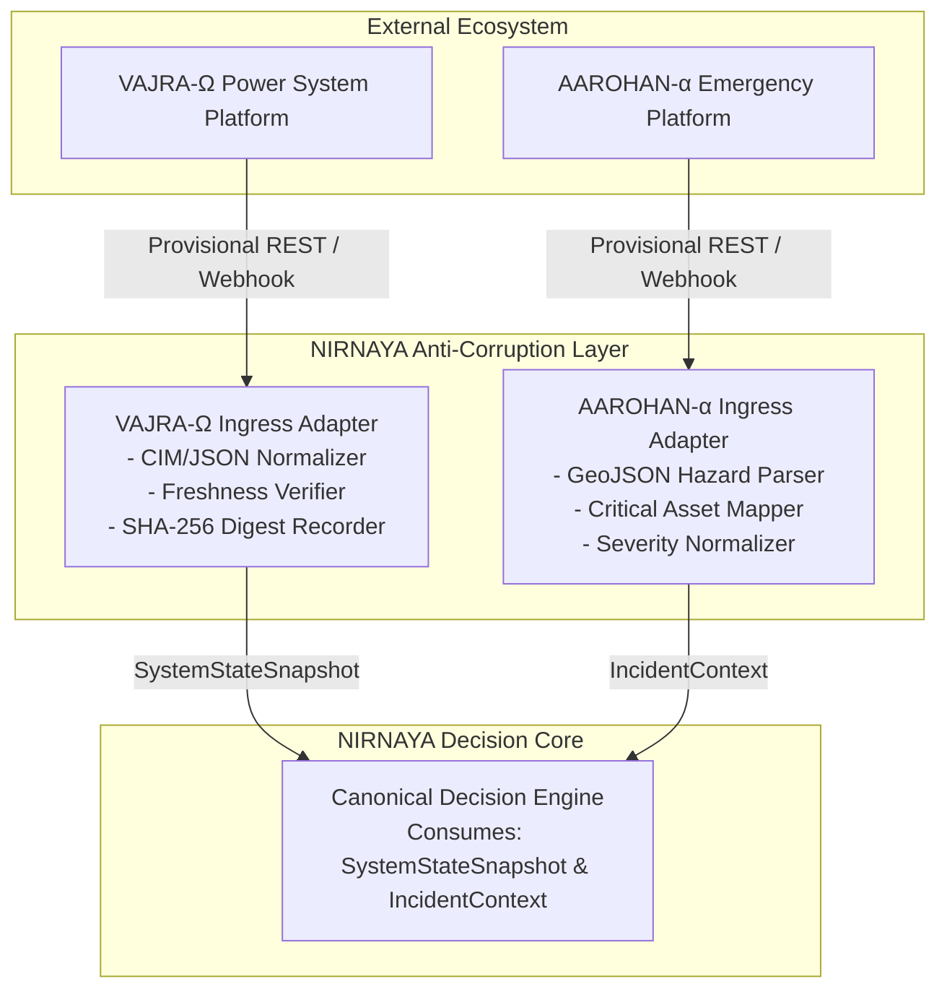

# NIRNAYA — Integration Contracts Specification

## Document Metadata
- **Status:** PROVISIONAL — FOR ARCHITECTURAL REVIEW
- **Phase:** 0 — Engineering Foundation
- **Classification:** External & Internal Canonical Interface Specification
- **Author:** Principal Software Architect & Systems Engineering Lead

---

## 1. Integration Invariants & Governing Principles

To maintain system integrity, safety, and operational independence, all integrations with NIRNAYA must adhere to ten non-negotiable invariants:

1. **Independent Repositories & Release Lifecycles:** NIRNAYA, VAJRA-Ω, and AAROHAN-α reside in independent source repositories, maintain distinct versioning schemes, and deploy autonomously.
2. **Explicit Data Ownership:** External domain systems own their models and telemetry. NIRNAYA never mutates external state and acts strictly as an analytical decision-support layer.
3. **No Shared Operational Database:** Communication between systems occurs exclusively via versioned contracts over explicit network interfaces. No direct cross-system database connections are permitted.
4. **Read-Only Domain Ingress:** In Phase 0 through Phase 4, NIRNAYA consumes external state snapshots in read-only mode.
5. **Cryptographic Provenance & Timestamps:** Every ingested payload must include originating source timestamps, source entity IDs, and a cryptographic digest (`sha256:hash`) of the raw bytes.
6. **Strict Freshness Envelopes:** Real-time decision-making mandates current data. Telemetry older than 30 seconds triggers visual degraded-state warnings; telemetry older than 120 seconds triggers a **Fail-Closed Lockout** preventing new scenario evaluations.
7. **Fail-Closed Safety Handling:** Any payload that fails schema validation, contains corrupted fields, or represents an unresolvable domain state results in an explicit `UNKNOWN` classification.
8. **Bounded Retries & Idempotency:** Ingress polling and webhook handlers enforce exponential backoff with jitter and a maximum of 3 retries. All state processing must be idempotent based on UUID and payload hashes.
9. **No Direct Operational Command Actuation:** NIRNAYA never directly controls physical grid actuators, switches, or breakers. Output plans are exported for human operator execution.
10. **Strict Decoupling of Recommendation vs. Authorization:** System-generated recommendations have zero operational legal standing until explicitly reviewed and cryptographically signed by authorized human personnel.

---

## 2. Canonical Contracts Summary & Schema Inventory

NIRNAYA defines seven core canonical contracts under `contracts/schemas/` with corresponding concrete validation examples in `contracts/examples/`.

| Contract Identifier | Canonical Schema File | Concrete Example File | Semantic Role |
| :--- | :--- | :--- | :--- |
| **`SystemStateSnapshot`** | [`contracts/schemas/system_state_snapshot.json`](file:///d:/My%20Projects/NIRNAYA-%CE%A3/contracts/schemas/system_state_snapshot.json) | [`contracts/examples/system_state_snapshot.example.json`](file:///d:/My%20Projects/NIRNAYA-%CE%A3/contracts/examples/system_state_snapshot.example.json) | Ingests electrical network topology, bus voltages, line flows, and equipment limits from VAJRA-Ω. |
| **`IncidentContext`** | [`contracts/schemas/incident_context.json`](file:///d:/My%20Projects/NIRNAYA-%CE%A3/contracts/schemas/incident_context.json) | [`contracts/examples/incident_context.example.json`](file:///d:/My%20Projects/NIRNAYA-%CE%A3/contracts/examples/incident_context.example.json) | Ingests hazard geometries (wildfire, flood), civil incident alerts, and critical facility priorities from AAROHAN-α. |
| **`DecisionProblem`** | [`contracts/schemas/decision_problem.json`](file:///d:/My%20Projects/NIRNAYA-%CE%A3/contracts/schemas/decision_problem.json) | [`contracts/examples/decision_problem.example.json`](file:///d:/My%20Projects/NIRNAYA-%CE%A3/contracts/examples/decision_problem.example.json) | Formulates the formal 7-tuple $\mathcal{D} = (S, A, C, O, M, U, E)$ binding state, constraints, objectives, and evidence. |
| **`ScenarioDefinition`** | [`contracts/schemas/scenario_definition.json`](file:///d:/My%20Projects/NIRNAYA-%CE%A3/contracts/schemas/scenario_definition.json) | [`contracts/examples/scenario_definition.example.json`](file:///d:/My%20Projects/NIRNAYA-%CE%A3/contracts/examples/scenario_definition.example.json) | Specifies an executable intervention scenario with exact parameter assignments and contingency disturbance timelines. |
| **`ModelEvaluation`** | [`contracts/schemas/model_evaluation.json`](file:///d:/My%20Projects/NIRNAYA-%CE%A3/contracts/schemas/model_evaluation.json) | [`contracts/examples/model_evaluation.example.json`](file:///d:/My%20Projects/NIRNAYA-%CE%A3/contracts/examples/model_evaluation.example.json) | Encapsulates numerical solver outputs, hard constraint compliance summaries, and objective values with confidence intervals. |
| **`StrategyComparison`** | [`contracts/schemas/strategy_comparison.json`](file:///d:/My%20Projects/NIRNAYA-%CE%A3/contracts/schemas/strategy_comparison.json) | [`contracts/examples/strategy_comparison.example.json`](file:///d:/My%20Projects/NIRNAYA-%CE%A3/contracts/examples/strategy_comparison.example.json) | Contains non-dominated Pareto frontier sets, dominated sets, trade-off matrices, and evidence-grounded narratives. |
| **`DecisionRecord`** | [`contracts/schemas/decision_record.json`](file:///d:/My%20Projects/NIRNAYA-%CE%A3/contracts/schemas/decision_record.json) | [`contracts/examples/decision_record.example.json`](file:///d:/My%20Projects/NIRNAYA-%CE%A3/contracts/examples/decision_record.example.json) | Represents the auditable, legally binding, human-authorized decision with dual-control digital signatures and SHA-256 hash chaining. |

---

## 3. Detailed Specification of Canonical Contracts

### 3.1 `SystemStateSnapshot`
- **Purpose:** Authoritative physical grid state representation consumed by NIRNAYA to anchor decision formulation.
- **Required Fields:** `snapshot_id`, `schema_version`, `domain`, `source_system`, `source_timestamp`, `ingested_at`, `freshness_seconds`, `telemetry_quality`, `payload_hash`, `state_data`.
- **Field Semantics & Units:**
  - `grid_frequency_hz`: Float, nominal 50.0 or 60.0 Hz ($\pm 0.01$ Hz precision).
  - `voltage_magnitude_pu`: Per-unit voltage relative to nominal kV ($1.0 \text{ p.u.} = \text{nominal}$).
  - `active_flow_mw` / `thermal_rating_mva`: Megawatts / Megavolt-amperes.
  - `priority_tier`: Integer 1 to 5 (1 = Critical Life-Support / Hospital, 5 = Interruptible Industrial).
- **Error Behavior:** If `freshness_seconds > 120.0`, state is flagged `STALE_LOCKOUT`, rejecting any new case generation.

### 3.2 `IncidentContext`
- **Purpose:** Ingests dynamic civil and environmental threat context.
- **Required Fields:** `incident_id`, `schema_version`, `source_system`, `reported_at`, `severity_level`, `incident_type`, `status`, `impact_zone`, `critical_assets_at_risk`.
- **Field Semantics & Units:**
  - `impact_zone.coordinates`: GeoJSON compliant longitude-latitude array defining polygon perimeters.
  - `critical_assets_at_risk.backup_power_hours_remaining`: Hours of diesel/battery runtime remaining before complete facility blackout.
  - `wind_gust_mps`: Meters per second ($1 \text{ m/s} \approx 3.6 \text{ km/h}$).

### 3.3 `DecisionProblem`
- **Purpose:** Immutable container for the formal decision formulation $\mathcal{D} = (S, A, C, O, M, U, E)$.
- **Required Fields:** `problem_id`, `schema_version`, `created_at`, `decision_maker_context`, `state_snapshot_id`, `incident_context_ids`, `candidate_actions`, `hard_constraints`, `soft_constraints`, `objectives`, `domain_model_references`, `uncertainty_parameters`, `evidence_chain`.
- **Field Semantics:** Ties candidate discrete/continuous actions to explicit mathematical constraints and objectives with verified units.

### 3.4 `ScenarioDefinition`
- **Purpose:** Parameterized execution instance dispatched to scientific simulation workers.
- **Required Fields:** `scenario_id`, `problem_id`, `schema_version`, `strategy_name`, `strategy_type`, `selected_action_ids`, `action_parameter_assignments`, `contingency_disturbance_timeline`, `solver_configuration`, `simulation_seed`.
- **Field Semantics:**
  - `simulation_seed`: 64-bit integer guaranteeing deterministic random sampling for pseudo-stochastic disturbances.
  - `contingency_disturbance_timeline`: Ordered sequence of secondary line trips, generator trips, or storm squall arrivals with temporal offsets in seconds.

### 3.5 `ModelEvaluation`
- **Purpose:** Formal numerical report returned by domain simulation workers.
- **Required Fields:** `evaluation_id`, `scenario_id`, `schema_version`, `evaluated_at`, `execution_duration_ms`, `outcome_state`, `model_envelope_satisfied`, `hard_constraint_summary`, `objective_metrics`, `reproducibility_fingerprint`.
- **Feasibility Tri-State Semantics:**
  - `FEASIBLE`: Evaluated successfully with zero hard constraint violations.
  - `INFEASIBLE`: Identified one or more physical violations (e.g., line overload, voltage collapse). Contains exact numerical magnitude of violation.
  - `UNKNOWN`: Solver exceeded convergence iterations, timed out, or operated outside validated physics boundary. **Safety Rule:** Must never be converted into `FEASIBLE`.

### 3.6 `StrategyComparison`
- **Purpose:** Synthesis of multi-objective rankings, Pareto classification, and trade-off matrices.
- **Required Fields:** `comparison_id`, `problem_id`, `schema_version`, `generated_at`, `baseline_scenario_id`, `pareto_frontier_scenario_ids`, `dominated_scenario_ids`, `infeasible_scenario_ids`, `unknown_scenario_ids`, `tradeoff_matrix`, `evidence_explanation`.
- **Trade-Off Matrix Semantics:** Explicitly pairs each candidate scenario against the counterfactual baseline $x_0$, documenting objective deltas and maximum regret under bounded uncertainty.

### 3.7 `DecisionRecord`
- **Purpose:** Cryptographically signed, legally binding operational decision dossier.
- **Required Fields:** `record_id`, `problem_id`, `comparison_id`, `schema_version`, `created_at`, `selected_scenario_id`, `authorization_state`, `human_review_log`, `dual_control_signatures`, `audit_trail`.
- **Dual-Control Semantics:**
  - `primary_sign_off`: Digital signature from certified Senior Grid Controller.
  - `secondary_sign_off`: Mandatory secondary digital signature from Incident Commander or Operations Director when load curtailment exceeds policy thresholds ($>10 \text{ MW}$).
  - `audit_trail.record_hash`: $\text{SHA256}(\text{record\_id} \parallel \text{problem\_id} \parallel \text{selected\_scenario\_id} \parallel \text{previous\_record\_hash})$.

---

## 4. Domain Adapter Responsibilities & Discovery Roadmap

Because VAJRA-Ω and AAROHAN-α are developed independently, NIRNAYA implements dedicated Ingress Adapters acting as an Anti-Corruption Layer.

### 4.1 VAJRA-Ω Adapter Responsibilities & Discovery Work
The VAJRA-Ω adapter must normalize external power-system data into `SystemStateSnapshot`. Before implementing the adapter in Phase 4, the following discovery tasks must be completed with the VAJRA-Ω engineering team:

1. **Schema & Model Standard Alignment:** Determine whether VAJRA-Ω exports network topology in IEC 61970 Common Information Model (CIM) XML, JSON-LD, or a proprietary JSON format.
2. **Telemetry Ingress Transport:** Verify if VAJRA-Ω supports asynchronous pub/sub streaming (e.g., Apache Kafka, NATS JetStream) or synchronous HTTPS REST polling.
3. **Solver Execution Locality:** Confirm whether power-flow simulations run on VAJRA-Ω compute nodes (requiring NIRNAYA to submit simulation requests) or if NIRNAYA executes an embedded solver using network parameters provided by VAJRA-Ω.
4. **Dynamic Rating Availability:** Determine if ambient weather-adjusted dynamic line ratings (DLR) are published or if static seasonal limits apply.

### 4.2 AAROHAN-α Adapter Responsibilities & Discovery Work
The AAROHAN-α adapter normalizes emergency incident feeds into `IncidentContext`. Discovery tasks for Phase 4:

1. **Hazard Geometry Precision:** Confirm coordinate reference systems (CRS) used by AAROHAN-α (defaulting to EPSG:4326 / WGS 84).
2. **Facility Criticality Taxonomy:** Reconcile asset classifications between municipal emergency management and electric utility priority feeder lists (e.g., matching hospital substation feeder IDs to emergency trauma registries).
3. **Update Frequency & Event Triggers:** Establish whether incident perimeters are pushed on revision or polled periodically.

---

## 5. Schema Evolution & Compatibility Rules

All canonical contracts enforce strict semantic versioning rules:

1. **Semantic Versioning Format:** `vMAJOR.MINOR.PATCH` (e.g., `v1.0.0`).
2. **Additive Non-Breaking Changes (MINOR):** Adding optional fields, expanding enum choices, or adding descriptive metadata increments MINOR. Consumers must ignore unknown fields rather than fail.
3. **Breaking Schema Changes (MAJOR):** Renaming required fields, removing fields, altering physical units, or changing coordinate representations increments MAJOR and requires adapter deprecation cycles.
4. **Contract Verification:** All CI/CD pipelines validate example payloads against their respective schemas using standard JSON Schema Draft-07 validators before code merges.
