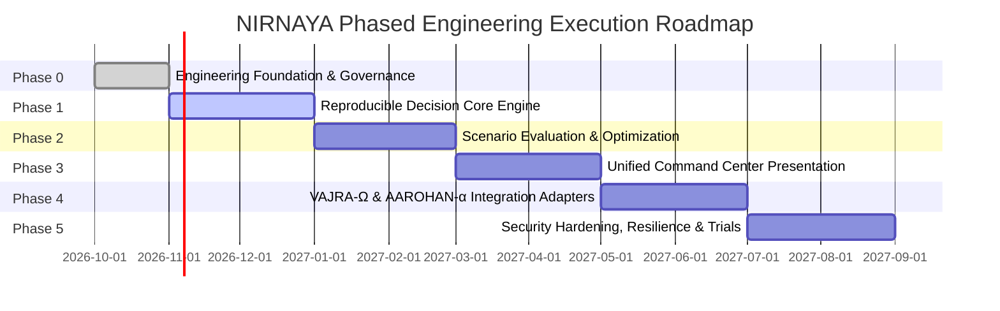
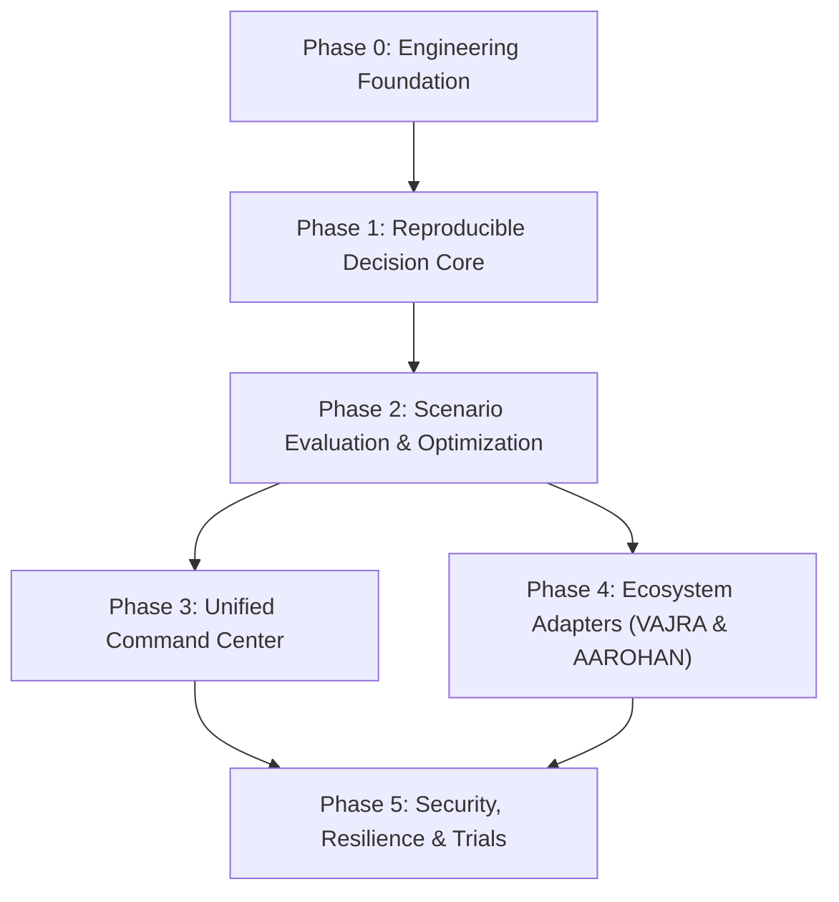

# NIRNAYA — Engineering Execution Roadmap

## Document Metadata
- **Status:** PROVISIONAL — FOR ARCHITECTURAL REVIEW
- **Phase:** 0 — Engineering Foundation
- **Classification:** Strategic & Phased Engineering Roadmap
- **Author:** Principal Software Architect & Systems Engineering Lead

---

## 1. Phased Architecture & Execution Overview

NIRNAYA follows a disciplined six-phase evolutionary trajectory designed to eliminate architectural debt and de-risk mathematical and operational integration before building user-facing features or external adapters.

---

## 2. Phase-by-Phase Execution Specifications

### Phase 0: Engineering Foundation (Current Phase)
- **Objective:** Establish the complete mathematical, architectural, and contractual foundation without introducing speculative application code.
- **Prerequisites:** Accessible workspace, clear problem mission, and ecosystem boundary definitions.
- **Concrete Deliverables:**
  - Full Phase 0 documentation suite under `docs/`.
  - Seven canonical JSON Schema contracts under `contracts/schemas/`.
  - Seven validated concrete example instances under `contracts/examples/`.
  - Architectural Decision Records (`docs/architecture/decision-log.md`).
- **Verification Steps:**
  - Automated schema validation using Python `jsonschema.Draft7Validator`.
  - Markdown internal link and reference crawler.
  - Mermaid diagram syntax validation.
- **Exit Gate:** Architectural review and formal sign-off by project owner.

---

### Phase 1: Reproducible Decision Core
- **Objective:** Build the deterministic, in-memory Python decision engine implementing $D = (S, A, C, O, M, U, E)$.
- **Prerequisites:** Phase 0 exit gate approval; initialized Python project with pytest and Pydantic v2.
- **Concrete Deliverables:**
  - Pure domain models (`services/decision-core/domain/`) mapping the 7-tuple.
  - Hard constraint verification module with numerical tolerance handling ($g_i(x) \le \epsilon_{\text{tol}}$).
  - Tri-state feasibility classifier (`FEASIBLE`, `INFEASIBLE`, `UNKNOWN`).
  - Unit and property-based test suites using Hypothesis.
- **Verification Steps:**
  - Verify $100\%$ detection of artificial constraint violations across $1,000$ synthetic test cases.
  - Assert zero floating-point nondeterminism across repeated runs with identical seeds.
- **Exit Gate:** All core mathematical domain tests pass; 100% schema conformance on generated evaluation records.

---

### Phase 2: Scenario Evaluation & Optimization
- **Objective:** Integrate scientific solvers (HiGHS, SciPy, OR-Tools) and multi-objective Pareto optimization.
- **Prerequisites:** Phase 1 decision core complete; solver libraries compiled and verified.
- **Concrete Deliverables:**
  - Non-dominated sorting engine (NSGA-II core) computing Pareto frontiers $\mathcal{P}^*$.
  - Counterfactual baseline comparator calculating relative deltas ($\Delta f_k$) and maximum regret.
  - Monte Carlo Latin Hypercube Sampling (LHS) module for aleatory uncertainty.
  - Asynchronous compute worker integration via Celery/Redis.
- **Verification Steps:**
  - Benchmark non-dominated sorting against IEEE 14-bus and IEEE 118-bus test feeders.
  - Test worker crash recovery: assert unacknowledged jobs are requeued and deduplicated.
- **Exit Gate:** Sub-second Pareto frontier calculation for $N=50$ scenarios on IEEE 118-bus; deterministic seed locking verified.

---

### Phase 3: Unified Command Center Interface
- **Objective:** Implement the real-time operational dashboard connecting geospatial maps, Pareto plots, and dual-control sign-offs.
- **Prerequisites:** Phase 2 API endpoints functional; WebSocket event stream ready.
- **Concrete Deliverables:**
  - React 18/19 + TypeScript + Vite frontend application in `apps/command-center/`.
  - MapLibre GL JS integration rendering transmission lines, substations, and hazard polygons.
  - Interactive 2D/3D Pareto trade-off visualizer with non-dominated front highlighting.
  - Strict 5-tier visual epistemic categorization badges (`MEASURED`, `SIMULATED`, `PREDICTED`, `RECOMMENDATION`, `APPROVED ACTION`).
  - Dual-control authorization pad with digital signature capture.
- **Verification Steps:**
  - End-to-end Playwright tests simulating complete dispatcher review and sign-off flows.
  - WCAG 2.1 AA accessibility audit and keyboard navigation verification.
- **Exit Gate:** 60 FPS geospatial rendering under 10,000 vector elements; complete user flow test pass.

---

### Phase 4: VAJRA-Ω and AAROHAN-α Integration
- **Objective:** Implement production Anti-Corruption Layer adapters for live external systems.
- **Prerequisites:** Phase 3 UI complete; discovery tasks completed with VAJRA-Ω and AAROHAN-α teams.
- **Concrete Deliverables:**
  - `integrations/vajra-adapter/`: Ingests power grid topology and physics evaluations.
  - `integrations/aarohan-adapter/`: Ingests GeoJSON emergency hazard perimeters and critical facility lists.
  - Telemetry freshness monitor enforcing degraded ($>30$s) and fail-closed ($>120$s) states.
  - Circuit breakers and retry policies for external network calls.
- **Verification Steps:**
  - Ingress chaos testing: inject network partitions, delayed packets, and malformed schemas.
  - Verify fail-closed lockout occurs within 120 seconds of telemetry loss.
- **Exit Gate:** Continuous telemetry ingestion without memory leakage; zero unhandled schema exceptions.

---

### Phase 5: Security Hardening, Resilience, & Operational Trials
- **Objective:** Execute end-to-end security audits, red-teaming, hardware-in-the-loop validation, and control-room drills.
- **Prerequisites:** Phase 4 integration adapters operational; staging cluster deployed.
- **Concrete Deliverables:**
  - Mutual TLS (mTLS) deployment across all internal and adapter communications.
  - Append-only SHA-256 hash-chained decision audit trail with automated tamper detection.
  - Docker containerization and Kubernetes / Helm deployment configurations in `infra/`.
  - Control room training manual and incident replay test suite.
- **Verification Steps:**
  - Penetration testing targeting prompt injection, RBAC privilege escalation, and database tampering.
  - Human-factors simulation drill with certified grid operators.
- **Exit Gate:** Zero high/critical security vulnerabilities; formal regulatory compliance sign-off.

---

## 3. Dependency Graph & Critical-Path Risk Register

### Critical-Path Risk Register

| Risk ID | Risk Description | Likelihood | Impact | Critical Path Impact | Proactive Mitigation Strategy |
| :--- | :--- | :---: | :---: | :---: | :--- |
| **RSK-01** | **External Schema Volatility:** VAJRA-Ω or AAROHAN-α change data models unexpectedly. | High | High | Blocks Phase 4 adapter completion. | Anti-Corruption Layer with strict canonical internal schemas; versioned contract negotiation. |
| **RSK-02** | **AC-OPF Solver Non-Convergence:** Non-linear AC power flow fails to converge during severe contingencies. | High | High | Delays Phase 2 optimization. | Fallback hierarchy: DCPF screening $\rightarrow$ localized ACOPF $\rightarrow$ explicit `UNKNOWN` fail-closed flag. |
| **RSK-03** | **Telemetry Freshness Latency:** Network latency between control centers exceeds the 30-second freshness window. | Medium | High | Triggers premature fail-closed lockouts. | Edge caching, binary protobuf/gRPC compression, and localized streaming proxies. |
| **RSK-04** | **Operator Cognitive Overload:** Dense multi-objective visualizations confuse operators during high-stress events. | Medium | Medium | Hampers Phase 3 adoption. | Co-design UI with active control room dispatchers; provide lexicographic default filters. |
| **RSK-05** | **LLM Hallucination Risk:** Generative explanations inject subtle factual inaccuracies into decision records. | Medium | Critical | Compromises legal auditability. | Strict post-generation regex assertion against verified numerical JSON metrics; fallback templates. |
