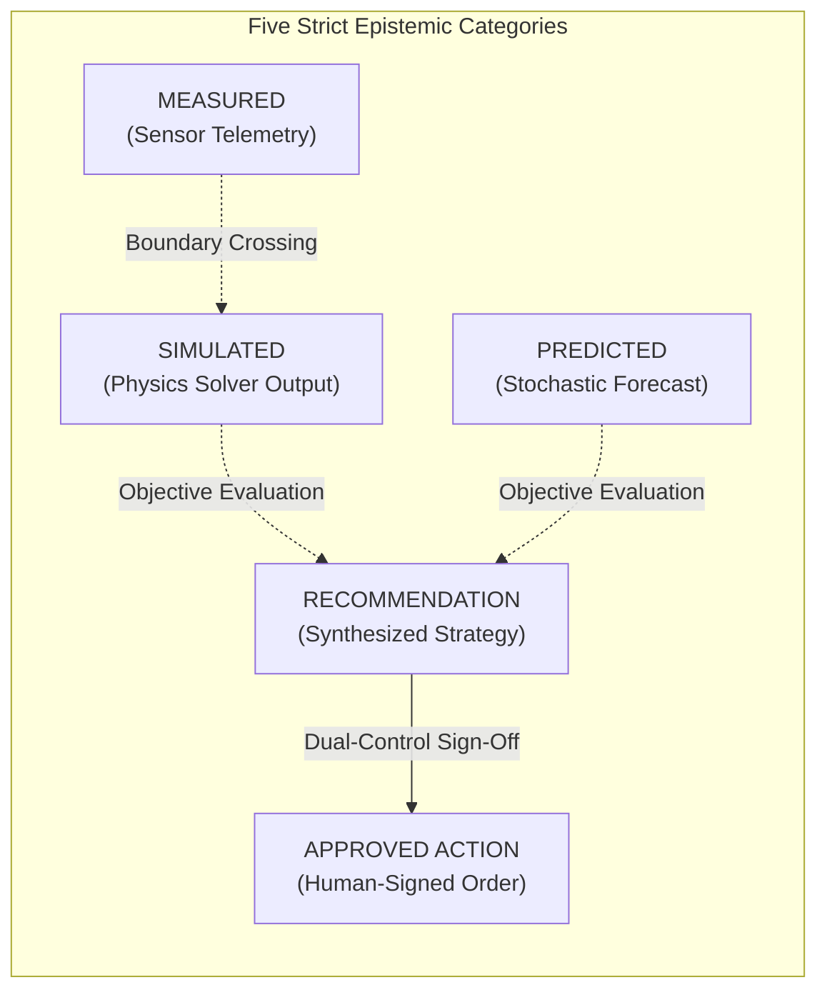
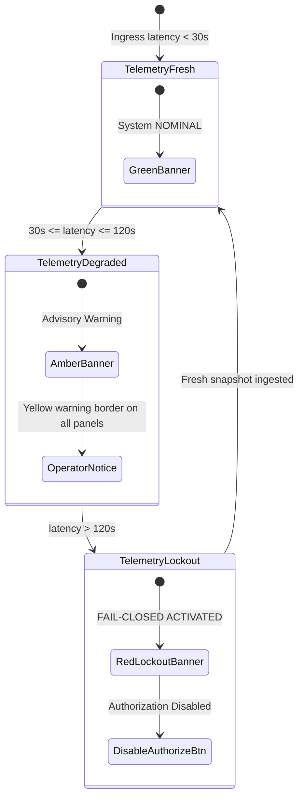

# NIRNAYA — Unified Command Center UI/UX Specification

## Document Metadata
- **Status:** PROVISIONAL — FOR ARCHITECTURAL REVIEW
- **Phase:** 0 — Engineering Foundation
- **Classification:** Human-Computer Interface (HCI) & Control Room UX Specification
- **Author:** Principal Software Architect & Systems Engineering Lead

---

## 1. Design Philosophy & Ergonomic Mandates

The **NIRNAYA Unified Command Center (UCC)** is engineered as a high-density, low-latency operational decision cockpit designed for electric utility grid control centers and joint emergency operations rooms.

### Fundamental Ergonomic Principles
1. **Zero Cognitive Concealment:** Critical operational data, active physical bottlenecks, and trade-offs must be visible simultaneously without navigating deep nested modal trees.
2. **Strict Epistemic Category Distinction:** The interface must make it visually impossible for an operator under extreme fatigue to confuse raw telemetry, model physics, statistical forecasts, system suggestions, and human authorizations.
3. **Fail-Closed Situational Awareness:** Stale telemetry, degraded data, or model divergence must trigger prominent visual warnings that inhibit unverified operational sign-offs.
4. **Ergonomic Control Room Standards:** Strict adherence to WCAG 2.1 AA accessibility, high-contrast dark palette tailored for 24/7 video walls and operator workstations, and full keyboard accessibility.

---

## 2. Visual Epistemic Categorization System

Every data element, badge, chart curve, and map layer in the Unified Command Center is assigned one of five strict epistemic categories, each bound to a standardized visual token:

| Epistemic Category | Operational Meaning | Visual Token / Badge Style | Example Elements |
| :--- | :--- | :--- | :--- |
| **`MEASURED`** | Verifiable empirical observation directly sampled from physical field sensors or SCADA. | Solid Emerald Green border, glowing status dot, timestamp attached. | Bus voltage (0.982 p.u.), line active flow (520 MW), ambient wind speed (32 m/s). |
| **`SIMULATED`** | Deterministic numerical output generated by a validated physics solver (e.g., DCPF, ACOPF). | Solid Cyan / Blue accent, solver engine tag, convergence indicator. | Post-contingency line loading (84.5%), bus voltage phase angle, reserve margins. |
| **`PREDICTED`** | Statistical forecast, ML inference, or stochastic distribution over future time steps. | Dashed Purple border, confidence interval bracket ($\pm 2\sigma$), model version. | 2-hour storm gust track, solar irradiance dip, probability of secondary trip ($P = 0.18$). |
| **`RECOMMENDATION`** | System-generated candidate strategy synthesized by NIRNAYA optimization core. | Indigo / Amber highlight, "ADVISORY ONLY" badge, non-dominated frontier rank. | Candidate switching plan, generator redispatch schedule, feeder curtailment list. |
| **`APPROVED ACTION`** | Human-authorized operational order bearing verified digital signatures. | High-contrast Solid Green fill, cryptographic seal icon, dual-signoff watermark. | Formally signed dispatch order exported for SCADA execution. |



---

## 3. Command Center Information Architecture & Screen Layout

The Unified Command Center employs a **4-Quadrant Master-Detail Layout** optimized for dual-monitor or ultra-wide (32:9 / 21:9) control room displays:

```
┌────────────────────────────────────────────────────────────────────────────────────────────────────────┐
│ TOP BAR: System Status (NOMINAL/DEGRADED) | Ingress Freshness (1.8s) | Active Incident | User: OP-9842 │
├───────────────────────────────────────────┬────────────────────────────────────────────────────────────┤
│ QUADRANT 1: GEOSPATIAL OPERATIONAL CONTEXT│ QUADRANT 2: TELEMETRY & INCIDENT FEEDS                     │
│ - MapLibre GL WebGL Map                   │ - Active AAROHAN-α Incidents & Warnings                    │
│ - 400kV / 220kV Transmission Topologies   │ - Critical Facility Vulnerability Table (Hospitals, etc.)  │
│ - Substation Pins with Status Rings       │ - VAJRA-Ω Ingress Quality & Freshness Countdown            │
│ - Dynamic Hazard Polygons (Wind/Flood)    │ - Hard Constraint Violation Alerts                         │
├───────────────────────────────────────────┼────────────────────────────────────────────────────────────┤
│ QUADRANT 3: MULTI-OBJECTIVE TRADE-OFFS    │ QUADRANT 4: DECISION DOSSIER & AUTHORIZATION               │
│ - Interactive 2D/3D Pareto Frontier       │ - Evidence-Backed Explanation & Factor Attribution         │
│ - Side-by-Side Candidate Comparison Table │ - Counterfactual Delta Analysis vs. Baseline               │
│ - Sensitivity & Sobol Index Spider Chart  │ - Dual-Control Sign-Off Pad (Primary + Secondary)          │
│ - Maximum Regret under Uncertainty        │ - Hash-Chained Audit Trail & Export Button                 │
└───────────────────────────────────────────┴────────────────────────────────────────────────────────────┘
```

### Quadrant Breakdown & Interaction Workflows

#### Quadrant 1: Shared Geospatial Operational Context (Top-Left)
- **Map Renderer:** MapLibre GL JS utilizing custom vector tiles for power transmission networks.
- **Topological Layers:**
  - Transmission lines colored by thermal loading: Green ($<80\%$), Amber ($80-99\%$), Pulsing Red ($\ge 100\%$, Overloaded), Dashed Grey (Tripped/De-energized).
  - Substations rendered with status rings indicating bus voltage stability ($V_{\min} \le V \le V_{\max}$).
  - Overlay of GeoJSON hazard polygons from AAROHAN-α (e.g., storm squall perimeters, flood zones).
- **Interactions:** Clicking any line or substation filters the feeds in Quadrant 2 and highlights affected candidate actions in Quadrant 3.

#### Quadrant 2: Telemetry & Incident Feeds (Top-Right)
- **Incident Stream:** Chronological feed of incoming alarms from AAROHAN-α and SCADA event logs.
- **Critical Facility Status Table:** Real-time monitoring of Tier-1 facilities (e.g., Metropolitan Apex Trauma Centre) showing backup diesel hours remaining, connected substation, and supply stability.
- **Telemetry Freshness Monitor:** Real-time countdown timer displaying seconds since last verified `SystemStateSnapshot`. Automatically triggers amber warning at $>30$s and red lockout at $>120$s.

#### Quadrant 3: Multi-Objective Trade-Off & Pareto Exploration (Bottom-Left)
- **Pareto Scatter Plot:** Visualizes evaluated scenarios across user-selected objective axes (e.g., $X$-axis: Expected Unserved Energy in MWh, $Y$-axis: Redispatch Cost in USD, Point Size: Critical Facility Outage Hours).
- **Non-Dominated Curve Overlay:** Highlights the non-dominated Pareto frontier $\mathcal{P}^*$; dominated solutions are dimmed; infeasible solutions are rendered in red with violation tooltips.
- **Side-by-Side Strategy Diff:** Allows selecting up to 3 candidate strategies to view a structured differential comparison table against the counterfactual baseline $x_0$.

#### Quadrant 4: Decision Review, Explanation, & Dual-Control Authorization (Bottom-Right)
- **Evidence-Backed Narrative Panel:** Displays fact-checked natural language explanations detailing why the selected strategy is mathematically non-dominated and which physical bottlenecks were relieved.
- **Dual-Control Authorization Pad:**
  - For standard reconfigurations: Displays primary sign-off field with digital signature capture.
  - For high-impact actions (curtailment $>10$ MW or islanding): Enforces secondary sign-off workflow, displaying the required secondary authorizer role (e.g., Emergency Operations Director) and waiting for concurrent authentication.
- **Audit Chain Verification:** Displays real-time SHA-256 hash chaining of the decision dossier with verification status ("AUDIT PROVENANCE VERIFIED").

---

## 4. State Handling, Telemetry Degradation, and Alerts

The Command Center provides deterministic visual indicators for all system and network states:



### Stale Data & Degraded State Rules
1. **Fresh State ($<30$s):** Banner displays solid green `SYSTEM NOMINAL — TELEMETRY FRESH (1.2s)`. All scenario evaluations and authorizations permitted.
2. **Degraded State ($30$s to $120$s):** Banner switches to amber with an audible alert: `DEGRADED TELEMETRY — INGRESS AGE: 48s`. Evaluated scenarios display an amber badge: `DEGRADED CONFIDENCE`.
3. **Lockout State ($>120$s):** System enters **Fail-Closed Lockout**. Top bar turns high-contrast red: `FAIL-CLOSED: TELEMETRY STALE (>120s) — SYSTEM LOCKED`. The "Authorize Decision" button is disabled and replaced with a lockout explanation.

---

## 5. Keyboard Navigation & Accessibility Specifications

Control room operators frequently operate under intense stress and must not be delayed by imprecise mouse navigation:
- **Global Hotkeys:**
  - `Alt + 1` through `Alt + 4`: Focus directly to Quadrants 1 through 4.
  - `Space`: Toggle between Pareto Scatter Plot and Tabular Comparison view.
  - `Tab / Shift+Tab`: Cycle through non-dominated candidate strategies in rank order.
  - `Ctrl + Enter`: Trigger Primary Authorization modal (requires explicit password/biometric confirmation).
  - `Esc`: Dismiss active modal or clear map filter.
- **Colorblind-Safe Design:** All charts and status indicators combine color with redundant geometric glyphs (e.g., green circle, yellow triangle, red octagon).
- **Audible Alerts:** Distinct, non-jarring acoustic chimes for telemetry degradation, critical constraint violations, and dual-control signature requests.
