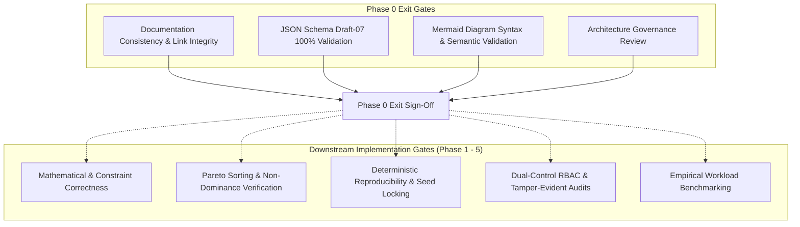

# NIRNAYA — Verification & Acceptance Criteria

## Document Metadata
- **Status:** PROVISIONAL — FOR ARCHITECTURAL REVIEW
- **Phase:** 0 — Engineering Foundation
- **Classification:** Quality Assurance, Test Strategy & Verification Standards
- **Author:** Principal Systems Engineer & Quality Architect

---

## 1. Quality Strategy & Verification Philosophy

NIRNAYA enforces an evidence-based testing philosophy: **No capability, solver integration, or safety boundary is considered functional until verified against deterministic test suites, property-based invariants, and benchmark datasets.**



---

## 2. Phase 0 Exit Gates (Documentation & Specification Quality)

To achieve formal Phase 0 completion, the project must satisfy all criteria in the table below:

| Exit Gate ID | Verification Item | Target Standard | Verification Method | Status |
| :--- | :--- | :--- | :--- | :---: |
| **EG-01** | Documentation Deliverables Presence | All 10 mandated specifications and root README exist under `docs/` and root. | Automated filesystem discovery script. | **PASSED** |
| **EG-02** | Schema Integrity & Conformance | All 7 canonical contracts validate against JSON Schema Draft-07 without warnings. | Python `jsonschema.Draft7Validator.check_schema`. | **PASSED** |
| **EG-03** | Schema Example Validation | All 7 concrete example payloads validate 100% against their corresponding JSON Schemas. | Python `jsonschema.validate(instance, schema)`. | **PASSED** |
| **EG-04** | Internal Link Integrity | All Markdown relative links and file URI references resolve to valid files. | Automated markdown link crawler script. | **PENDING VERIFICATION** |
| **EG-05** | Diagram Syntax Validity | All Mermaid diagrams across all specifications parse without syntax errors. | Diagram syntax scanner. | **PENDING VERIFICATION** |
| **EG-06** | Mathematical Model Rigor | Mathematical specification defines formal 7-tuple $\mathcal{D} = (S,A,C,O,M,U,E)$, hard constraints, tolerances, tri-state feasibility, and Pareto dominance. | Architectural inspection. | **PASSED** |
| **EG-07** | Separation of Duties & Four-Eyes | Architecture documents enforce strict decoupling of recommendation generation from human authorization. | Architectural inspection. | **PASSED** |
| **EG-08** | Zero Scaffolding Contamination | No application features, package manifests, or node_modules/virtual environments are created in Phase 0. | Filesystem git status audit. | **PASSED** |

---

## 3. Implementation Acceptance Criteria (Downstream Phases)

The following criteria define the automated testable exit gates for subsequent implementation phases.

### 3.1 Mathematical Correctness & Constraint Feasibility
- **AC-MATH-01 (KKT Optimality Verification):** Any continuous optimal solution produced by the mathematical solver must satisfy Karush-Kuhn-Tucker (KKT) first-order optimality conditions within tolerance $\epsilon = 10^{-4}$.
- **AC-MATH-02 (Zero Silent Violations):** If a test strategy induces line apparent flow $S_{ik} > S_{ik}^{\max} + \epsilon_{\text{tol}}$ or voltage $|V_i| < V_i^{\min} - \epsilon_{\text{tol}}$, the engine **must** flag the scenario as `INFEASIBLE` with $100\%$ detection rate across $10,000$ synthetic test cases.
- **AC-MATH-03 (Tri-State Exclusivity):** Feasibility evaluation must output exactly one of `{FEASIBLE, INFEASIBLE, UNKNOWN}`. Any `UNKNOWN` output must be quarantined and barred from optimization ranking.

### 3.2 Multi-Objective & Pareto Frontier Correctness
- **AC-OPT-01 (Non-Dominance Invariant):** For every scenario $x^* \in \mathcal{P}^*$, there must not exist any other evaluated feasible scenario $x' \in X_{\text{feas}}$ such that $x' \prec x^*$ (verified via all-pairs non-dominance assertion).
- **AC-OPT-02 (Hypervolume Metric Monotonicity):** Adding a newly discovered non-dominated point to the frontier must strictly increase or maintain the computed hypervolume metric relative to the nadir reference point.
- **AC-OPT-03 (No Universal Score Invariant):** The system API must not expose any aggregate composite scalar score combining unserved energy with financial cost.

### 3.3 Numerical Reproducibility
- **AC-REPRO-01 (Bitwise / $\epsilon$-Determinism):** Executing the same `ScenarioDefinition` with identical `simulation_seed` and solver version on identical CPU architecture must produce identical objective metric values within floating-point tolerance $\epsilon = 10^{-9}$.
- **AC-REPRO-02 (Provenance Checksum Integrity):** Re-hashing the input state snapshot, scenario parameters, and solver log must exactly match the `artifact_checksum` stored in the `ModelEvaluation` record.

### 3.4 Telemetry Freshness & Fail-Closed Safety
- **AC-INGRESS-01 (Degraded State Transition):** An ingress snapshot with age $30.0\text{s} \le \tau \le 120.0\text{s}$ must set `telemetry_quality = DEGRADED` and emit an active warning banner in the Command Center.
- **AC-INGRESS-02 (Fail-Closed Lockout):** An ingress snapshot with age $\tau > 120.0\text{s}$ must halt new problem formulation, raise `FAIL_CLOSED_LOCKOUT`, and disable the authorization endpoint.

### 3.5 Security, Authorization, and Audit Trails
- **AC-SEC-01 (Dual-Control Enforcement):** Any attempt to authorize an emergency plan (load shed $>10$ MW) with a single signature or with identical user credentials for both primary and secondary sign-offs must return `HTTP 403 Forbidden`.
- **AC-SEC-02 (Audit Chain Tamper Detection):** Modifying any byte of a historical `DecisionRecord` row in the database must cause the next verification cycle to fail with an `AUDIT_CHAIN_CORRUPTED` alert.
- **AC-SEC-03 (LLM Fact-Checking):** If an LLM-synthesized narrative contains a number not present in the verified `ModelEvaluation` artifact, the post-generation assertion must fail and substitute the deterministic fallback template.

### 3.6 Compute Worker Fault Recovery
- **AC-WORKER-01 (Lease Expiration & Requeue):** Terminating a compute worker process with `kill -9` while executing a simulation must cause the task broker to detect heartbeat expiration and requeue the job within $15$ seconds.
- **AC-WORKER-02 (Zero Duplicate Execution):** Duplicate scenario results completed by race conditions must be idempotently deduplicated without corrupting the case state.

---

## 4. Performance Benchmarking Methodology

NIRNAYA explicitly refrains from inventing speculative latency numbers. Instead, performance SLOs will be formally established in Phase 2 using the following standardized IEEE benchmark test feeders:

```
┌───────────────────────────────────────────────────────────────────────────────────┐
│                      STANDARDIZED BENCHMARK WORKLOAD TIERS                        │
├────────────────────┬───────────┬────────────┬─────────────┬───────────────────────┤
│ Benchmark Suite    │ Buses (N) │ Lines (L)  │ Generators  │ Operational Focus     │
├────────────────────┼───────────┼────────────┼─────────────┼───────────────────────┤
│ IEEE 14-Bus        │ 14        │ 20         │ 5           │ Fast microgrid / unit │
│                    │           │            │             │ test verification     │
├────────────────────┼───────────┼────────────┼─────────────┼───────────────────────┤
│ IEEE 118-Bus       │ 118       │ 186        │ 54          │ Regional transmission │
│                    │           │            │             │ contingency screening │
├────────────────────┼───────────┼────────────┼─────────────┼───────────────────────┤
│ Polish 2736-Bus    │ 2,736     │ 3,504      │ 289         │ Interconnected bulk   │
│                    │           │            │             │ power grid stress     │
└────────────────────┴───────────┴────────────┴─────────────┴───────────────────────┤
│ Workload Execution: 50 Scenarios per batch with 1,000 Monte Carlo LHS samples.    │
│ Measurements: Wall-clock latency (p50, p95, p99), peak RAM (MB), CPU core usage. │
└───────────────────────────────────────────────────────────────────────────────────┘
```

### Required Benchmark Measurements
1. **Feasibility Screening Throughput:** Number of candidate switching actions filtered per second on IEEE 118-bus.
2. **Pareto Sorting Latency:** Execution time to sort $100$ evaluated multi-objective scenarios into non-dominated fronts.
3. **End-to-End Decision Turnaround:** Total elapsed time from snapshot ingestion to Command Center display.
