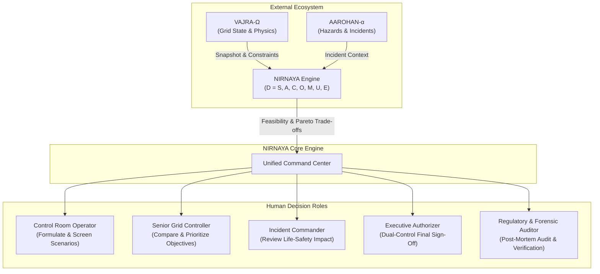
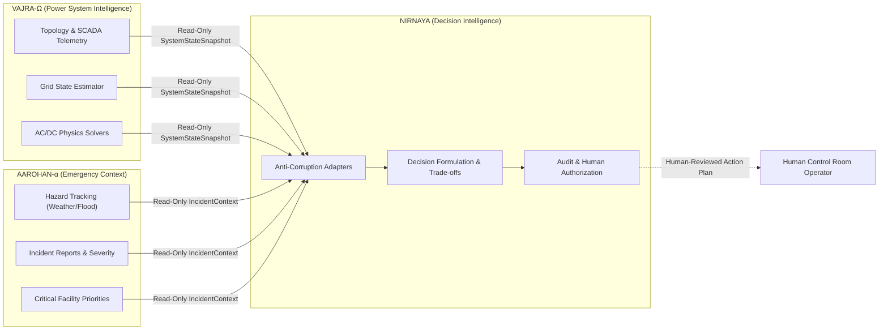

# NIRNAYA — Mission, Scope, and Operational Boundaries

## Document Metadata
- **Status:** PROVISIONAL — FOR ARCHITECTURAL REVIEW
- **Phase:** 0 — Engineering Foundation
- **Classification:** System Specification & Governance Charter
- **Author:** Principal Software Architect & Systems Engineering Lead

---

## 1. Executive Summary & Mission Statement

**NIRNAYA (निर्णय — Sanskrit for *Discernment, Adjudication, or Resolutive Decision*)** is an AI Decision Intelligence Engine engineered to evaluate complex, safety-critical operational situations, formulate and compare feasible intervention strategies, execute validated model-based simulations, quantify systemic uncertainty, and deliver mathematically grounded, auditable recommendations to human decision-makers.

NIRNAYA is **not** a generic conversational chatbot, **not** a decorative monitoring dashboard, and **not** an autonomous closed-loop grid controller. It bridges the critical cognitive and analytical chasm between raw telemetry ingestion, physics-based simulations, and high-consequence operational decisions under stress, severe time pressure, and incomplete information.

### The Seven Fundamental Inquiries of NIRNAYA

Every decision-support workflow orchestrated by NIRNAYA must rigorously resolve seven fundamental inquiries:

1. **What is happening?** — Ingest, validate, and contextualize operational state, topological telemetry, active disturbances, and environmental conditions into an authoritative situational picture.
2. **What actions are feasible?** — Filter combinatorial actions against hard physical, operational, and safety constraints to define the strictly feasible action space.
3. **What outcomes are expected under each strategy?** — Evaluate candidate interventions across multi-physics domain models and predictive simulators.
4. **Which strategies perform best against stated objectives?** — Execute multi-objective optimization across competing operational priorities (e.g., life safety, unserved energy, equipment thermal fatigue, restoration latency, economic cost).
5. **What assumptions, uncertainties, risks, and evidence gaps affect the comparison?** — Perform stochastic sensitivity, Monte Carlo sampling, and bounded robustness analysis to quantify risk exposure.
6. **Why is one strategy preferable under selected priorities?** — Generate transparent, mathematically grounded trade-off rationales and counterfactual explanations without relying on opaque composite scores.
7. **Who reviewed and authorized the resulting decision?** — Record human review, explicit dual-control authorizations, cryptographic signatures, and provenance chains into an immutable decision record.

---

## 2. Target Users & Operational Workflows

NIRNAYA is designed for high-stress control rooms, emergency response operations centers, and post-incident forensic audit environments.

### Primary User Personas & Responsibilities

| Role | Operational Context | Primary Responsibilities in NIRNAYA | Authority Boundaries |
| :--- | :--- | :--- | :--- |
| **Grid Control Dispatcher** | Real-time transmission/distribution control room | Initiates decision cases; selects candidate switching/redispatch actions; triggers simulation runs. | Can screen scenarios; cannot authorize high-impact emergency curtailment alone. |
| **Senior Grid Controller / Shift Supervisor** | Transmission operations command | Reviews objective weightings; analyzes Pareto frontiers; evaluates $N-1$ contingency robustness; signs primary authorization. | Authorized to approve grid reconfigurations within standard operating limits; requires dual sign-off for emergency load shed. |
| **Incident Commander (EOC)** | Joint Emergency Operations Center | Reviews civil-protection impacts; monitors critical infrastructure (hospitals, water pumping stations); coordinates civil-grid priorities. | Co-authorizes civil-priority preservation orders; does not directly command electrical switching equipment. |
| **Reliability & Risk Analyst** | Engineering operations / Planning | Configures uncertainty distributions; tunes model fidelity envelopes; validates constraint tolerances; performs post-event replays. | Read/write access to model configurations; no real-time dispatch authority. |
| **Regulatory & Safety Auditor** | Compliance, Reliability Council, Legal | Inspects immutable audit trails; verifies cryptographic proofs; analyzes decision timeliness and constraint compliance. | Read-only access to historical Decision Records and evidence chains. |

---

## 3. Initial Domain Focus: Power-Grid Incident & Outage Decision Support

The initial domain instantiation of NIRNAYA focuses on **Bulk Power Transmission, Substation Contingencies, and Severe Weather Grid Resilience**.

Power systems operate under rigid physical laws governing real and reactive power flow (Kirchhoff's laws), generator rotor dynamics, frequency regulation, and thermal conductor limits. During extreme weather events (e.g., severe windstorms, floods, ice accumulation) or physical/cyber contingencies:
- Multiple transmission lines trip concurrently or sequentially.
- Substations become isolated or islanded.
- Generation-load imbalances risk frequency collapse (under-frequency load shedding).
- Operators must make decisions within minutes with hundreds of megawatts and critical life-support infrastructure at stake.

In this environment, NIRNAYA provides decision intelligence for:
1. **Contingency Response:** Rapidly identifying restorative redispatch, transformer tap adjustments, and line switching options following $N-k$ line trips.
2. **Controlled Islanding vs. Interconnection Preservation:** Determining whether to split an asynchronous or unstable section of the grid to prevent cascading collapse.
3. **Critical Facility Preservation:** Optimizing load-shedding schedules to guarantee continuous feeds to Tier-1 critical infrastructure (trauma centers, municipal water pumping, emergency communications).
4. **Black-Start & Phased Restoration:** Sequencing crank paths, black-start diesel/hydro units, and load pickup blocks while managing reactive power and inrush currents.

---

## 4. In-Scope Capabilities vs. Explicit Non-Goals

To maintain uncompromising reliability, NIRNAYA enforces strict functional and architectural boundaries.

### In-Scope Capabilities
- **Formal Decision Problem Ingestion:** Programmatic ingestion and representation of the decision tuple $D = (S, A, C, O, M, U, E)$.
- **Multi-Fidelity Constraint & Feasibility Filtering:** Independent evaluation of candidate strategies against hard physical and operational constraints before optimization ranking.
- **Pareto Trade-Off Surface Derivation:** Multi-objective optimization producing non-dominated sets across competing metrics (e.g., unserved energy vs. asset fatigue vs. financial cost).
- **Stochastic & Bounded Robustness Analysis:** Monte Carlo sampling (Latin Hypercube), parameter sensitivity indices (Sobol), and worst-case regret analysis over bounded uncertainty sets.
- **Evidence-Backed Explanations:** Generation of factor-attribution narratives, dual-variable shadow-price explanations, and counterfactual comparisons grounded strictly in verified simulation outputs.
- **Dual-Control Human Authorization Workflow:** Enforced Four-Eyes Principle sign-offs, digital signatures, and tamper-evident hash-chained decision audit trails.

### Explicit Non-Goals
- **No Direct Telecontrol / SCADA Actuation:** NIRNAYA will **never** directly issue open/close breaker commands or setpoint adjustments to SCADA/EMS remotes in Phase 0 through Phase 4. Recommendations are exported as human-verifiable operational action plans.
- **No Replacement of Domain Physics Solvers:** NIRNAYA does not reimplement proprietary full-fidelity AC-OPF or transient stability engines; it orchestrates and interfaces with domain engines (e.g., VAJRA-Ω, HiGHS, OpenDSS, MATPOWER) via standardized contracts.
- **No Universal Single-Scalar Scoring:** NIRNAYA will not condense complex, life-critical trade-offs into a single arbitrary scalar score (e.g., "Strategy Score: 87/100"). Trade-offs must remain visible across their natural physical units.
- **No Unconstrained or Hallucinatory LLM Computation:** Large Language Models are strictly sequestered from mathematical calculation, constraint checking, and optimization sorting. LLMs are restricted to structured natural-language explanation and query translation, conditioned on verified numerical artifacts.

---

## 5. Ecosystem & Integration Boundaries

NIRNAYA sits between two independent, authoritative domain platforms:

### Relationship with VAJRA-Ω (Power-System Intelligence)
- **Authority Boundary:** VAJRA-Ω is the sole authoritative source for electrical network state, impedance parameters, bus topologies, generator capability curves, and physics-model evaluations.
- **Interaction Contract:** NIRNAYA consumes read-only `SystemStateSnapshot` payloads and submits candidate strategies as `ScenarioDefinition` requests for physics verification.
- **Separation of Concerns:** VAJRA-Ω owns the physics; NIRNAYA owns the decision calculus (trade-offs, Pareto sorting, regret minimization, decision provenance).

### Relationship with AAROHAN-α (Emergency Context)
- **Authority Boundary:** AAROHAN-α is the authoritative source for emergency incident classifications, hazard perimeters (wildfire polygons, flood inundation maps), and civic asset criticality hierarchies.
- **Interaction Contract:** NIRNAYA consumes read-only `IncidentContext` payloads containing geo-tagged incident polygons and critical facility backup-power telemetry.
- **Separation of Concerns:** AAROHAN-α commands field rescue and civil defense; NIRNAYA ensures electrical grid decision-making preserves power to those civil operations.

---

## 6. Human Authority & Accountability Boundaries

NIRNAYA enforces the **Human-in-Command** paradigm. No decision is operationalized by the engine autonomously.

1. **Advisory by Construction:** The engine is exclusively a decision-support system. All outputs are advisory recommendations until formalized by an authorized human operator.
2. **Four-Eyes Principle (Dual Control):** For high-impact or emergency actions (such as intentional load shedding exceeding 10 MW or bus sectionalizing), NIRNAYA mandates concurrent cryptographic sign-offs from both a primary technical dispatcher and a secondary operational commander.
3. **Fail-Closed Default:** If an input telemetry snapshot is corrupt, stale, or marked `UNKNOWN`, or if the domain solver exceeds its numerical convergence envelope, NIRNAYA enters a fail-closed advisory state, issuing explicit alarms and refusing to mark any scenario as `FEASIBLE`.
4. **Immutable Legal & Forensic Record:** Every generated scenario, evaluated trade-off, human override, and operator rationale is serialized into an append-only, SHA-256 hash-chained `DecisionRecord`.

---

## 7. Definition of Success

### Phase 0 Success Criteria (Engineering Foundation)
- [x] Complete, mathematically rigorous documentation package establishing architecture, decision models, integration contracts, UI/UX, security, and verification.
- [x] Canonical JSON Schema specifications for all core contracts with 100% schema validation against example instances.
- [x] Zero application scaffolding or speculative implementation introduced prior to architectural approval.
- [x] Explicit identification of all system assumptions, risks, and unresolved integration questions.

### Operational Success Criteria (Post-Deployment System)
- **Zero Silent Infeasibility:** 100% of candidate strategies violating physical constraints are flagged as `INFEASIBLE` or `UNKNOWN`—never presented as viable.
- **Sub-Second Pareto Frontier Synthesis:** Pareto classification across $\ge 50$ multi-objective candidate scenarios computed in $< 500$ ms once physics outputs are available.
- **Full Traceability:** 100% of recommendations link directly to underlying input snapshots, constraint bounds, and solver seeds with verifiable cryptographic hashes.
- **Cognitive Load Reduction:** Grid controllers report a measurable reduction in decision formulation time during complex contingency drills without loss of situational awareness.

---

## 8. Assumptions, Constraints, and Unresolved Questions

### Confirmed Facts
1. The NIRNAYA workspace is currently empty, allowing a clean, disciplined Phase 0 engineering start.
2. The core system must integrate conceptually and architecturally with VAJRA-Ω and AAROHAN-α without assuming their APIs currently exist in this repository.
3. Python 3.14+ with standard JSON Schema validation is available in the local execution environment.

### Architectural Assumptions
- *Assumption 1:* VAJRA-Ω will expose state snapshots either via high-performance REST endpoints or asynchronous message streams (e.g., Kafka / NATS) conforming to the canonical `SystemStateSnapshot` schema.
- *Assumption 2:* Power flow solvers will provide explicit convergence indicators, dual variables, and bus voltage violation details rather than binary success codes.
- *Assumption 3:* AAROHAN-α can provide GeoJSON-compliant hazard geometries and standardized asset criticality tiers.

### Explicit Unresolved Questions
1. **Telemetry Ingress Transport:** Will VAJRA-Ω stream telemetry continuously over gRPC/Kafka or push snapshots on-demand via webhooks? *(Documented as provisional REST/JSON adapter with streaming extension hook).*
2. **Physics Solver Execution Locality:** Will VAJRA-Ω execute AC-OPF simulations on its own infrastructure and return `ModelEvaluation` artifacts, or will NIRNAYA bundle an embedded solver container for local evaluation? *(Documented to support both via solver adapter contracts).*
3. **Emergency Override Protocols:** What legal or operational protocol applies when human dispatchers are incapacitated or communication links are severed during an escalating blackout? *(Currently strictly bounded to fail-closed human advisory; autonomous operation is out of scope).*
